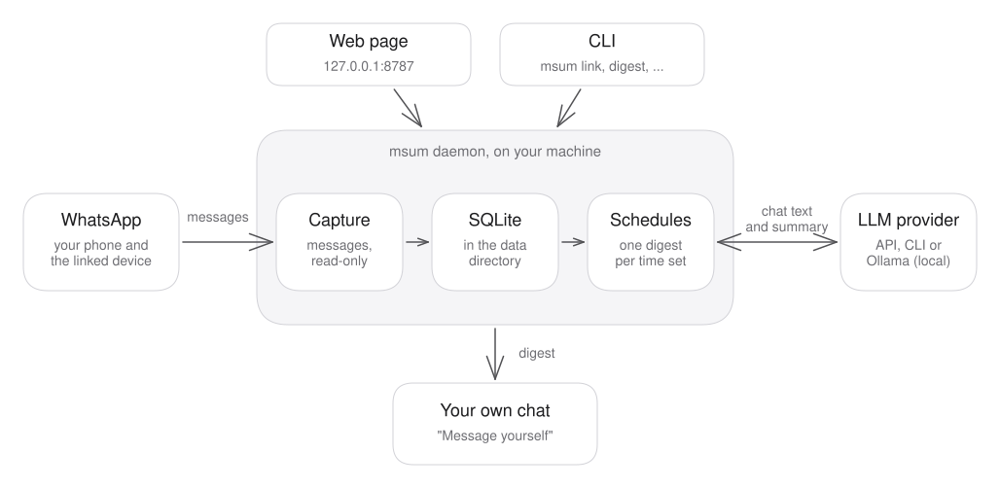
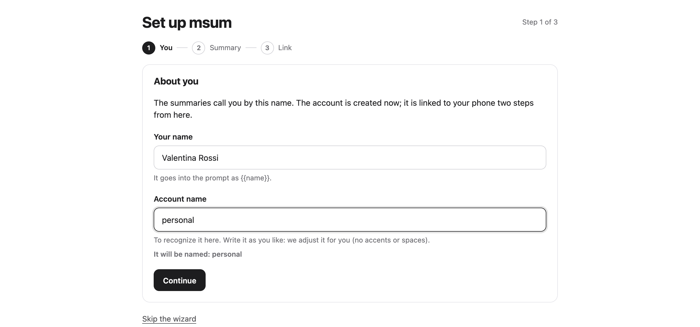
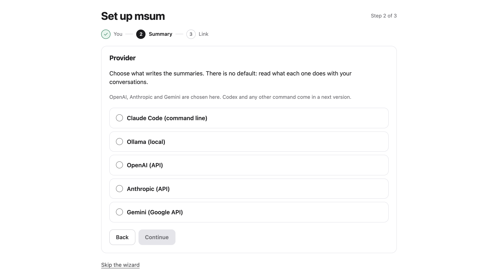
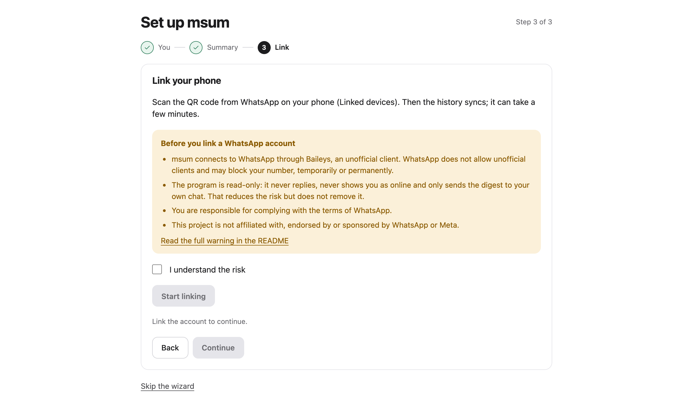
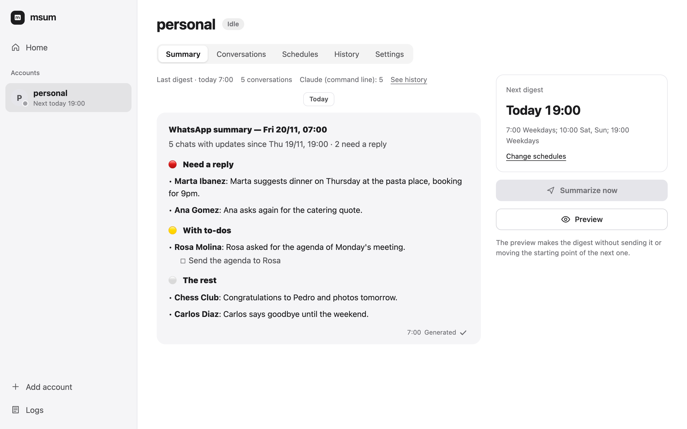
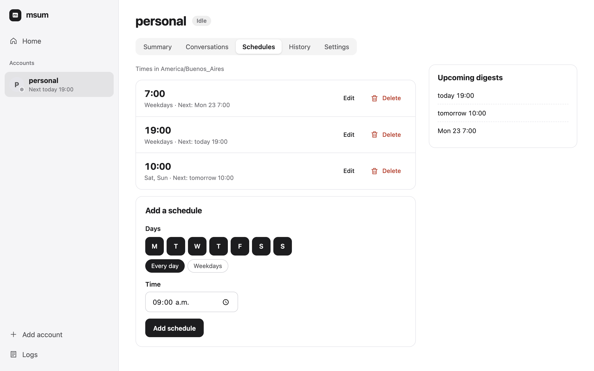
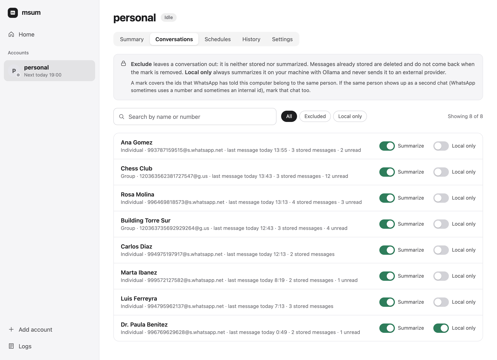
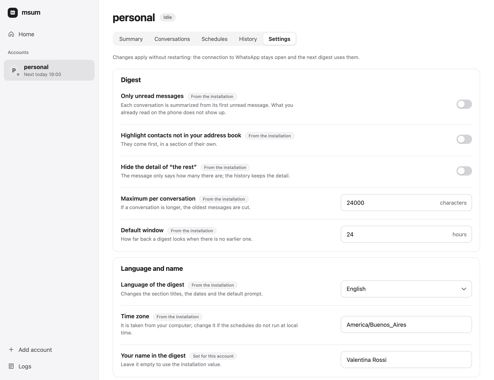
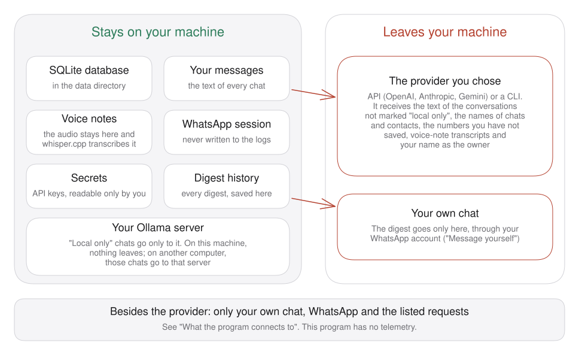

# message-summarize

[English](README.md)

Lee los mensajes que llegan a tu cuenta de mensajería, los resume con el modelo de lenguaje que elijas y te manda un resumen periódico: qué chats necesitan respuesta, qué quedó pendiente y qué podés ignorar. La primera plataforma soportada es **WhatsApp**; el núcleo no depende de ella, así que otras (Telegram, Slack, correo) se pueden sumar como adaptadores nuevos.



*Los mensajes se guardan en tu máquina, un LLM los resume en los horarios que definas y el resumen vuelve solo a tu propio chat.*

**Estado:** desarrollo temprano. Todavía no hay una versión publicada (ver [Limitaciones conocidas](#limitaciones-conocidas)); esperá asperezas. Los requerimientos aprobados están en [docs/requirements.md](docs/requirements.md) y el trabajo se organiza en las fases de la [hoja de ruta](#hoja-de-ruta).

## Qué hace

| Etapa | Qué hace |
|---|---|
| **Capturar** | Vincula tu cuenta escaneando un QR desde una página web local y la mantiene conectada sin marcarte "en línea", para que el celular siga recibiendo notificaciones. Guarda los mensajes solo en tu máquina (texto, y una representación en texto de imágenes, audios, documentos, encuestas, etc.). Opcional: transcribe los audios localmente con whisper.cpp; el audio nunca sale de tu máquina. Sin telemetría. |
| **Resumir** | Resume cada conversación con el LLM que elijas: por **API** (OpenAI y cualquier API compatible, Anthropic, Gemini), con **Ollama** en tu máquina, o por la **CLI** del proveedor (Claude Code o un comando genérico), aprovechando el plan que ya pagás; las CLIs corren sin herramientas, en un directorio vacío y con tiempo máximo. Podés marcar conversaciones como "solo local": únicamente las resume tu propio servidor de Ollama. Si `provider.ollama.baseUrl` es otra computadora, esos chats sí salen hacia ese servidor (ver la [guía de proveedores](docs/guias/proveedores.md#servidores-compatibles-y-solo-local)). |
| **Entregar** | Te manda el resumen a tu propio chat ("Mensaje a mí mismo"), ordenado en secciones: necesitan respuesta, tienen pendientes, el resto. Nunca se envía a nadie más, ni siquiera a otra cuenta de la misma instalación. |
| **Programar** | Corre en los horarios que definas desde la web (por ejemplo, 9:00 y 18:00 todos los días), además de "resumir ahora" y una vista previa que no envía nada. Maneja varias cuentas en una misma instalación, cada una con sus datos, configuración y horarios. Se instala con Docker o de forma nativa en macOS, Linux y Windows. |

## Por qué estas tecnologías

| Tecnología | Para qué | Por qué |
|---|---|---|
| [Baileys](https://github.com/WhiskeySockets/Baileys) | Conexión con WhatsApp | Es un cliente **no oficial** (ver el [aviso](#aviso-importante)); queda aislado en un adaptador, así que otras plataformas no tocan el núcleo. |
| `node:sqlite` | Almacenamiento | Viene con Node 22: ningún módulo nativo de npm que compilar. |
| `croner` | Horarios | Los horarios viven dentro del daemon; el programa nunca escribe en el cron ni en el planificador del sistema. |
| [whisper.cpp](https://github.com/ggml-org/whisper.cpp) | Transcripción de audios (opcional) | Corre en tu máquina: el audio no se envía a ningún servicio. |
| Proveedores de LLM: API, CLI y Ollama | Resumir cada conversación | Elegís entre pagar por uso (API), usar el plan que ya tenés (CLI sin herramientas) o no sacar nada de tu máquina (Ollama). |
| Svelte 5 + Vite | La página web local | Se compila a archivos estáticos que sirve el daemon; sin biblioteca de componentes. |

## Aviso importante

Leé esto antes de usar message-summarize con tu cuenta.

- **WhatsApp puede bloquear tu número.** message-summarize se conecta a través de [Baileys](https://github.com/WhiskeySockets/Baileys), un cliente **no oficial**. WhatsApp no permite clientes no oficiales y puede bloquear el número que los usa, de forma temporal o permanente. El proyecto intenta reducir ese riesgo (solo lectura, sin mensajes a terceros, sin marcarse en línea), pero no lo puede eliminar.
- **El programa es de solo lectura.** Lee los mensajes que llegan, nunca responde, nunca te marca en línea y nunca manda nada a terceros. El único mensaje que envía es el resumen, a tu propio chat ("Mensaje a mí mismo").
- **Modificar el programa o usarlo mal aumenta la probabilidad de un bloqueo.** Cambios que manden mensajes a otras personas, manden muchos mensajes, automaticen respuestas o cambien la forma en que el cliente se conecta pueden hacer que WhatsApp bloquee tu número. Si modificás el código, el riesgo es tuyo.
- **Tus datos se quedan en tu máquina, salvo lo que va al LLM que elijas.** Salvo que uses un modelo local (Ollama) o marques una conversación como "solo local", el texto de tus conversaciones se envía al proveedor que configures, bajo sus términos. Algunos planes gratuitos pueden usar ese contenido para mejorar sus productos, incluida la revisión humana.
- **La responsabilidad es tuya** de cumplir los términos de WhatsApp, los de tu proveedor de LLM y la ley de privacidad que se aplique a las conversaciones de terceros (las personas que te escriben) que leés y resumís.
- **No hay garantía.** El software se entrega "tal cual", como dice la [licencia](LICENSE). Los autores no responden por un número bloqueado, una conversación filtrada ni ningún otro daño.

Este proyecto no está afiliado, respaldado ni patrocinado por WhatsApp ni por Meta.

## Inicio rápido

### 1. Requisitos

- Una cuenta de WhatsApp y su celular, para escanear el QR (WhatsApp, Ajustes > Dispositivos vinculados).
- **Docker** o Docker Desktop, o bien **Node 22.16 o posterior** para la instalación nativa y el código fuente.
- Un proveedor de LLM. No hay uno por defecto: lo elegís en el paso 4.

  | Proveedor | Qué necesita |
  |---|---|
  | [Claude Code](https://claude.com/claude-code) | La sesión iniciada en esta máquina (`claude`). Usa tu plan, sin clave. |
  | [Ollama](https://ollama.com) | Un servidor local con un modelo ya descargado. Todo queda en tu máquina. |
  | OpenAI, Anthropic o Gemini | Una clave de API. |

El programa es de solo lectura: nunca te marca "en línea", nunca responde y nunca manda nada salvo el resumen, que va a tu propio chat. Leé primero el [aviso importante](#aviso-importante): esto usa un cliente no oficial y tu número puede ser bloqueado.

### 2. Instalar

**Todavía no hay una versión publicada.** Los instaladores están escritos y probados hasta donde permite una Mac, pero falta la primera versión (v0.1.0). Hasta entonces, usá Docker o el código fuente desde una copia del repositorio.

| Camino | Cómo |
|---|---|
| **Docker** (cualquier sistema, lo recomendado en Windows) | Ver abajo. |
| **macOS y Linux** | `sh packaging/install.sh` |
| **Windows** | El instalador `message-summarize-<versión>-win-x64-setup.exe` o `.\packaging\install.ps1` |
| **Código fuente** | `npm install`, `npm run build`, `node dist/main/cli.js init` |

**Docker.** Con Docker o Docker Desktop instalado, desde una copia del repositorio:

```sh
docker compose -f docker/compose.yaml up -d
docker compose -f docker/compose.yaml exec message-summarize msum open --print   # la dirección de la página web, con su token de acceso
```

- Los datos viven en el volumen `msum-data` y el contenedor se reinicia solo.
- La página web se publica solo en `127.0.0.1:8787`: no la cambies a otra dirección.
- Usá `docker compose -f docker/compose.yaml exec` (nunca `docker compose run`) para los comandos.
- El perfil `cli` (`docker compose -f docker/compose.yaml --profile cli up -d`) usa una imagen que además trae Claude Code, Gemini CLI y Codex, para quien quiera usar una CLI como proveedor. La sesión se inicia adentro del contenedor (ver [Usar una CLI como proveedor](docs/guias/cli-como-proveedor.md)). Gemini CLI y Codex están deshabilitadas por ahora.

**macOS y Linux.** `install.sh` no necesita permisos de administrador y no toca nada fuera de tu carpeta personal. Instala el programa (con su propia copia de Node.js, verificada contra el checksum oficial, si el tuyo es anterior a 22.16), registra el daemon como servicio de usuario y abre la página web.

```sh
sh packaging/install.sh              # desde una copia; --help lista las opciones
sh packaging/install.sh --uninstall  # quita el programa, nunca tus datos
```

Opciones: `--no-service`, `--no-open`, `--modify-path`, `--prefix <carpeta>`, `--tarball <archivo|url>`, `--dry-run`. Rechaza una carpeta que contenga o esté dentro del directorio de datos.

**Windows.** Dos caminos, ambos sin permisos de administrador: el instalador `message-summarize-<versión>-win-x64-setup.exe` que acompañará cada versión (todavía no está firmado, así que Windows SmartScreen va a avisar), o `install.ps1`, que hace lo mismo que `install.sh` (`.\packaging\install.ps1 -Help`). Al desinstalar se conservan tus datos. Windows en ARM: usá Docker.

**Código fuente.** Después de `npm install` y `npm run build`, `node dist/main/cli.js init` (o `msum init` después de `npm link`) crea el directorio de datos y `config.json`. Qué revisar en ese archivo, en la [guía del daemon](docs/guias/demonio-y-horarios.md#configuración-inicial-configjson).

**Dónde están los datos.**

| Sistema | Carpeta |
|---|---|
| macOS | `~/Library/Application Support/message-summarize` |
| Linux | `~/.local/share/message-summarize` |
| Windows | `%APPDATA%\message-summarize` |
| Cualquiera | La carpeta de `MSUM_DATA_DIR`, si la definís. |

Desinstalar nunca los borra; para quitar los datos de una cuenta usá `msum unlink`.

**Verificación de las versiones.** Cada versión trae un `SHA256SUMS.txt`. El paquete todavía no está en npm: la publicación está bloqueada a propósito hasta resolver la licencia de una dependencia (ver [Licencia](#licencia)).

### 3. Abrir la web y recorrer el asistente

`msum open` abre la página local con la sesión ya iniciada (con Docker, usá la dirección que imprime `msum open --print`). La dirección lleva un token de acceso: no la compartas.

La primera vez, en una instalación sin ninguna cuenta vinculada, empieza un asistente de tres pasos.

**Vos.** Tu nombre y el nombre de la cuenta. El idioma sigue al del navegador y la zona horaria es la del navegador; los dos se cambian después en Ajustes.



**Resumen.** Elegí el proveedor, mirá qué recibe y hacia quién, aceptá si sale de tu máquina y tocá **Probar conexión**.



**Vincular.** Leé el aviso de riesgo y marcá la casilla; después escaneá el QR desde WhatsApp y esperá la sincronización del historial.



Al terminar crea los horarios por defecto, 09:00 y 18:00 todos los días. Se puede cerrar a mitad y retomar, o saltear. Todo el detalle del asistente, de la página y de las aceptaciones está en la [guía de la web](docs/guias/web-y-cuentas.md).

Sin la web: `msum link` muestra el QR en la terminal (también queda como `qr.png` mientras es válido) y `msum daemon` conecta las cuentas, ejecuta los horarios y entrega cada resumen. Mirá la [guía del daemon](docs/guias/demonio-y-horarios.md).

### 4. Elegir y probar el proveedor

Cuatro comandos, en este orden (agregá `--account <id>` cuando hay más de una cuenta):

| Comando | Qué hace |
|---|---|
| `msum provider ls` | Lista cada proveedor: costo, si tus chats salen de la máquina, si está configurado y si es usable. Sin llamadas de red. |
| `msum provider use <nombre> --model <m>` | Elige el proveedor y su modelo, y dice qué archivo escribió. Antes de activar uno que envía tus chats afuera, te dice qué recibe y te pide confirmar. |
| `msum secret set <nombre>` | Guarda la clave de API (la lee de la entrada, nunca de un argumento). |
| `msum provider test` | UNA llamada real con una conversación inventada, nunca tus mensajes. Código de salida 0 si anda, 1 si no. |

Las configuraciones habituales:

| Quiero usar | Comandos |
|---|---|
| Claude Code con tu plan | `msum provider use claude-cli`, iniciar sesión con `claude`, `msum provider test` |
| API de Anthropic | `msum provider use anthropic --model claude-sonnet-5-5`, `msum secret set anthropic`, `msum provider test` |
| OpenAI | `msum provider use openai --model <modelo>`, `msum secret set openai`, `msum provider test` |
| Gemini | `msum provider use gemini --model <modelo>`, `msum secret set gemini`, `msum provider test` |
| Ollama, todo en tu máquina | `ollama pull <modelo>`, `msum provider use ollama --model <modelo>`, `msum provider test` |

Las claves de API nunca van en `config.json`. Un segundo proveedor de respaldo se agrega con `--backup`. Más en la [guía de proveedores](docs/guias/proveedores.md), [usar una CLI como proveedor](docs/guias/cli-como-proveedor.md), [elegir un modelo local](docs/guias/modelo-local-ollama.md) y las guías paso a paso de [Gemini](docs/guias/sacar-clave-api-google.md) y de [Claude Code](docs/guias/instalar-claude-y-login.md).

### 5. Horarios y vista previa

Cada cuenta corre sus digests en días de la semana a una hora local, manejados con `msum schedule`:

| Comando | Qué hace |
|---|---|
| `msum schedule ls` | Los lista con su id, días, hora y próxima ejecución. |
| `msum schedule add --time 09:00 [--days daily\|weekdays\|weekends\|mon,wed,fri\|mon-fri]` | Agrega uno (todos los días si no ponés `--days`). |
| `msum schedule rm <id>` | Borra uno. Para cambiar una hora, borrala y agregá la nueva. |

Un daemon en marcha toma los cambios en unos cinco segundos. Una cuenta nueva empieza sin horarios (el asistente de la web crea 09:00 y 18:00).

`msum digest --dry-run` genera un resumen ahora y lo muestra, sin guardar ni enviar nada. Sin `--dry-run` el resumen queda en cola y lo entrega el daemon que esté corriendo. Opciones: `--hours N`, `--from "AAAA-MM-DD HH:MM"`, `--to "AAAA-MM-DD HH:MM"`. Reglas de zona horaria, ejecuciones perdidas y configuraciones viejas en la [guía del daemon](docs/guias/demonio-y-horarios.md#horarios).

### 6. Uso diario

El daemon sirve la página local en `http://127.0.0.1:8787`; `msum open` la abre.



- **Horarios:** editarlos, "resumir ahora" y una vista previa que no envía nada.

  

- **Conversaciones:** listar, buscar y marcar cada chat como excluido o "solo local". Excluir un chat borra los mensajes guardados hasta ese momento.

  

- **Pedir:** pedir algo sobre los chats de un período, escribiendo o dictando (un resumen a medida, una lista de pedidos, qué dijo alguien). Arma una sola respuesta que el modelo escribe viendo todos los chats juntos (sin responder, no leídos o todos), la guarda en la base de la cuenta (las últimas 50) y, si lo dejás tildado, la manda solo a tu propio chat de WhatsApp; nunca a otra persona. El dictado lo hace tu navegador, que puede enviar el audio a Google o Apple. Ver la [guía de la web](docs/guias/web-y-cuentas.md#pedir-algo-sobre-tus-chats).

- **Ajustes:** proveedor, modelo, claves, nombre, idioma y zona horaria.

  

Otros comandos:

| Comando | Qué hace |
|---|---|
| `msum status` | Cuenta, último resumen, envíos pendientes, próximas ejecuciones y motivo de un bloqueo. |
| `msum doctor` | Revisa Node, permisos, configuración, proveedor, vinculación y, si está activada, la transcripción. |
| `msum accounts` | Lista las cuentas (`msum link --account trabajo` crea y vincula otra). |
| `msum retry --account <id>` | Levanta un bloqueo por conexión rechazada o reemplazada. |
| `msum service install\|uninstall\|status` | Registra solo el daemon para que arranque con tu sesión (launchd, `systemd --user` o una entrada `Run`), sin permisos de administrador. |
| `msum whisper models\|download <nombre>` | Modelos para la [transcripción de audios](docs/guias/transcripcion.md). |
| `msum import --from <ruta>` | [Importa desde la herramienta anterior](docs/guias/importar-herramienta-anterior.md) sin volver a escanear el QR. |
| `msum unlink` | **Borra todos los datos de la cuenta** (mensajes, audios, historial, envíos pendientes y la sesión de WhatsApp; la configuración queda) y pide confirmación. Después, quitá también el dispositivo en el celular. |

Todo queda en tu máquina, en el directorio de datos (con permisos solo para tu usuario), salvo lo que recibe el proveedor de LLM que elegiste. Los textos de la línea de comandos están en español o inglés (`language` en `config.json`).

## A qué se conecta el programa

No se envía nada a ningún lado salvo lo que sigue. No hay telemetría, y la transcripción nunca abre una conexión de red.

| Destino | Cuándo | Qué se envía |
|---|---|---|
| WhatsApp | Con una cuenta conectada | Tu propia conexión y la descarga de los audios que recibís, si la transcripción está activa. |
| El proveedor de LLM que elegiste | Al resumir o al responder un pedido de la pestaña "Pedir" | El texto de las conversaciones que no son solo locales, con tu prompt (o tu pedido). Con Ollama, la URL que configuraste; con una API, `api.openai.com` (o tu `baseUrl`), `api.anthropic.com` o `generativelanguage.googleapis.com`. |
| Servidores de Claude Code | Con `claude-cli` | El texto de los chats va a `api.anthropic.com`; el resto lo decide la propia CLI, no este programa (ver la guía). |
| Lista de modelos del proveedor | Al elegir un modelo en el asistente o en Ajustes | Un pedido sin texto de chats. |
| Tu servidor de Ollama | `msum ollama pull`, `msum doctor`, el selector de modelos de la web | El tag o un pedido de la lista de modelos, sin texto de chats. |
| Hugging Face | Solo con `msum whisper download` | El pedido del archivo del modelo, con checksum fijado. |



El dictado de la pestaña "Pedir" lo hace tu navegador, no este programa: según el navegador, el audio puede ir a Google o a Apple. Escribir el pedido no envía nada.

El detalle, host por host, en [A qué se conecta el programa](docs/guias/red-y-privacidad.md); qué hace cada proveedor con tus datos, en la [guía de proveedores](docs/guias/proveedores.md#privacidad-qué-hace-cada-proveedor-con-tus-datos).

## Estructura del repositorio

Arquitectura de puertos y adaptadores: las dependencias solo apuntan hacia adentro.

```
src/
  domain/            entidades y reglas (Conversation, Participant, Message, políticas del resumen)
  application/       casos de uso; ports/ tiene las interfaces (DeliveryChannel, Summarizer, DigestSource, ...)
  infrastructure/    adaptadores: whatsapp, llm/api, llm/cli, persistence/sqlite, transcription, scheduling, rendering
  interfaces/        cli, http, web
  main/              raíz de composición
test/
  unit/  contract/  golden/  fixtures/
```

`domain/` y `application/` nunca importan de `infrastructure/` ni de `interfaces/`. Una plataforma o un proveedor de LLM nuevo es un adaptador nuevo que pasa los tests de contrato de su puerto. Las reglas del proyecto están en [AGENTS.md](AGENTS.md).

## Solución de problemas

| Síntoma | Causa | Qué hacer |
|---|---|---|
| Una cuenta queda inactiva y `msum status` muestra un motivo | WhatsApp cerró la sesión, rechazó la conexión (403) o la reemplazó, o la sesión es de otro número. El daemon la bloquea (`accounts/<id>/blocked.json`) para no reconectar en bucle. | Si la conexión fue rechazada o reemplazada: `msum retry --account <id>` (la web ofrece reintentar). Después de un rechazo, la web hace esperar 30 minutos. |
| La sesión no sirve | Sesión muerta o cerrada desde el celular. | `msum unlink --account <id>` y después `msum link --account <id>`. Después, quitá el dispositivo viejo en el celular. |
| `msum link` o `msum unlink` rechaza la cuenta | El daemon la está usando (vinculada y sin bloqueo). | Detené el daemon primero. |
| `digest` o los horarios no funcionan | No hay proveedor: `init` escribe `"primary": null`. | `msum provider use <nombre> --model <modelo>` y `msum provider test`. |
| Falta la clave de API | El proveedor por API no tiene clave guardada. | `msum secret set <proveedor>` (o la variable de entorno). `msum doctor` dice cuál va a usar tu configuración. |
| El modelo de Ollama no está instalado | Con Ollama, el modelo configurado no se descargó. | `msum ollama pull <tag>`; `msum ollama recommend` lista los que entran en tu RAM. |
| "esta versión de X no se puede ejecutar sin herramientas" | Una CLI cuyo `--help` no muestra todos los flags de endurecimiento no se usa (regla RF-49). | Actualizá la CLI (se vuelve a revisar), usá otro proveedor, o definí un proveedor de respaldo. Ver [usar una CLI como proveedor](docs/guias/cli-como-proveedor.md). |
| Los horarios corren a una hora equivocada en Docker | Sin `TZ`, el contenedor usa UTC. | Definí `TZ` o `timezone` en la configuración. La web muestra la zona horaria en uso junto a los horarios. |
| La web no abre, o el puerto está ocupado | Otro programa usa el puerto 8787. | Nativo: cambiá `web.port` en `config.json` de la instalación. Docker: liberá el puerto 8787 del host y no cambies el puerto publicado (`127.0.0.1:8787:8787`): otro puerto responde 403. |
| Dos daemons sobre la misma sesión (WhatsApp desconecta uno) | Se usó `docker compose run` en vez de `exec`. | Usá siempre `docker compose -f docker/compose.yaml exec`. |
| Los audios aparecen como "audio sin transcribir" | La transcripción viene desactivada, o falta whisper, ffmpeg o el modelo. Un audio que falló no se reintenta. | `msum doctor` dice qué falta. Ver la [guía de transcripción](docs/guias/transcripcion.md). |

## Limitaciones conocidas

- Todavía no hay una versión publicada: falta la primera (v0.1.0).
- El instalador de Windows nunca corrió en una máquina Windows real, y todavía no está firmado. En Windows ARM, usá Docker.
- Una dependencia, `libsignal` (que trae Baileys), tiene licencia GPL-3.0 y falta resolver cómo se concilia con la licencia MIT (ver [Licencia](#licencia)).
- La publicación en npm está bloqueada a propósito hasta resolverlo.
- Gemini CLI y Codex están deshabilitados: no documentan una forma verificable de apagar sus herramientas (ver [usar una CLI como proveedor](docs/guias/cli-como-proveedor.md)). La CLI genérica puede ejecutarlos, bajo tu propio riesgo.
- Solo hay textos en español y en inglés.
- Por defecto la web escucha solo en esta máquina; `web.host` puede cambiarlo, y es una elección explícita; `web.allowedHosts` nombra los hosts de un proxy que pueden llegar a ella.

## Guías

El detalle de referencia está en [docs/guias](docs/guias/README.md) (español) y [docs/guides](docs/guides/README.md) (inglés):

| Guía | Qué explica |
|---|---|
| [Proveedores](docs/guias/proveedores.md) | Elegir y probar el proveedor de LLM, claves de API y privacidad de cada uno. |
| [Una CLI como proveedor](docs/guias/cli-como-proveedor.md) | La regla de "sin herramientas" y la CLI genérica. |
| [Transcripción](docs/guias/transcripcion.md) | whisper.cpp, opciones y límites. |
| [Lectura de imágenes](docs/guias/lectura-de-imagenes.md) | Opcional: el texto de las imágenes en los digests. La imagen sale de tu máquina. |
| [Modelo local (Ollama)](docs/guias/modelo-local-ollama.md) | Candidatos, evaluación y comandos `msum ollama`. |
| [Importar la herramienta anterior](docs/guias/importar-herramienta-anterior.md) | `msum import`. |
| [Red y privacidad](docs/guias/red-y-privacidad.md) | Todos los destinos de red. |
| [La web y las cuentas](docs/guias/web-y-cuentas.md) | La página, el asistente, exclusiones, aceptaciones y pedidos sobre tus chats. |
| [El daemon y los horarios](docs/guias/demonio-y-horarios.md) | `config.json`, bloqueos, varias cuentas y `msum schedule`. |
| [Clave de API de Google (Gemini)](docs/guias/sacar-clave-api-google.md) | Paso a paso. |
| [Instalar Claude Code e iniciar sesión](docs/guias/instalar-claude-y-login.md) | Paso a paso. |

## Hoja de ruta

| Fase | Objetivo |
|---|---|
| 0 | Tests de referencia (golden files) que capturan el comportamiento de la herramienta personal actual del autor, con conversaciones inventadas |
| 1 | Dominio y generación del resumen; fuente de WhatsApp y entrega al chat propio |
| 2 | Daemon, horarios, varias cuentas e importación desde la herramienta personal |
| 3 | Proveedores de LLM (API y CLI), proveedor de respaldo, conversaciones solo locales, transcripción con whisper.cpp y `doctor` |
| 4 | Web local: asistente de primer uso, vinculación por QR, panel, configuración, historial y logs |
| 5 | Empaquetado: imagen de Docker, instaladores para macOS, Linux y Windows, servicio del sistema |
| 6 | CI, chequeo de licencias, documentación y primera versión (v0.1.0) |

## Licencia

[MIT](LICENSE) para el código propio del proyecto. Una dependencia, `libsignal` (que trae Baileys, el cliente de WhatsApp), tiene licencia GPL-3.0; cómo se concilia con la licencia MIT hay que resolverlo antes de la primera versión (las opciones son reemplazarla, aislarla o cambiar la licencia; todavía no hay nada decidido), y `npm run check:licenses` la lista como excepción con nombre hasta entonces. La publicación en npm está bloqueada a propósito hasta que se decida. La lista completa de dependencias y sus licencias está en [THIRD_PARTY_NOTICES.md](THIRD_PARTY_NOTICES.md).

## Contribuir y seguridad

- [CONTRIBUTING.md](.github/CONTRIBUTING.md): cómo preparar el repositorio, los chequeos y las reglas para los cambios (en inglés).
- [SECURITY.md](.github/SECURITY.md): cómo reportar una vulnerabilidad de forma privada (en inglés).
- [THIRD_PARTY_NOTICES.md](THIRD_PARTY_NOTICES.md): las dependencias y sus licencias.
