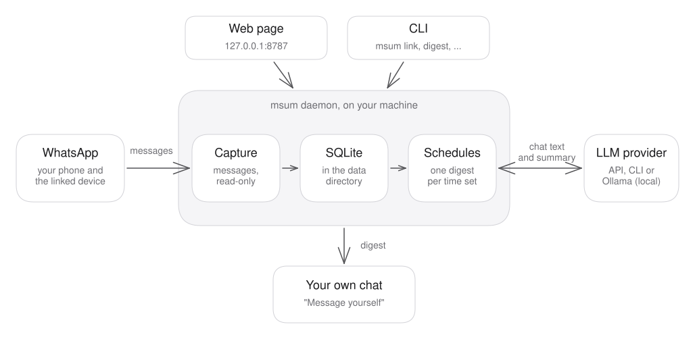
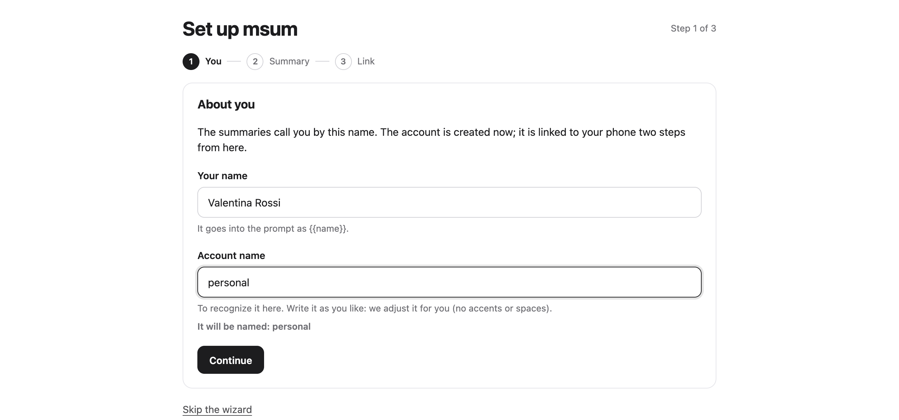
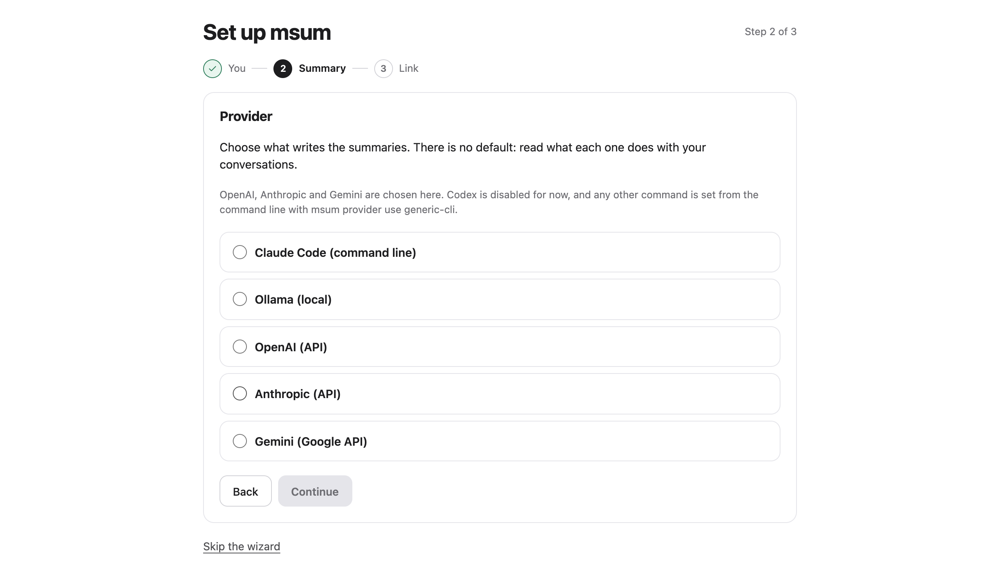
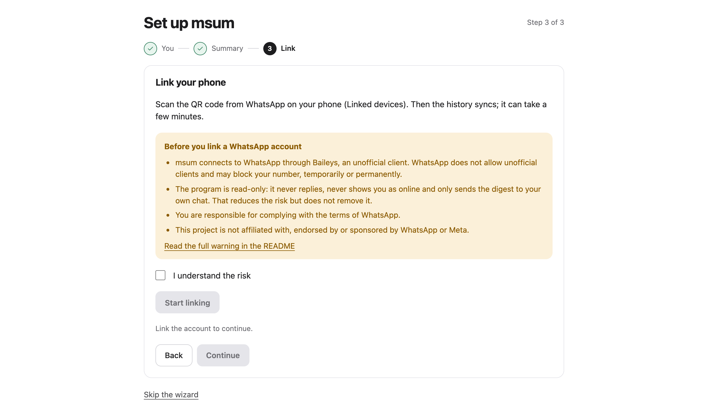
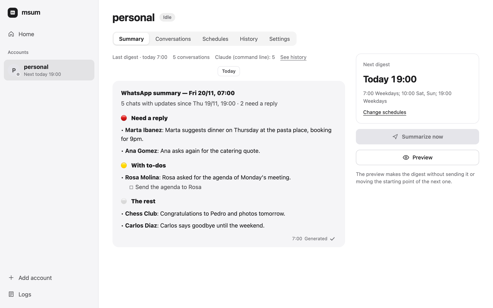
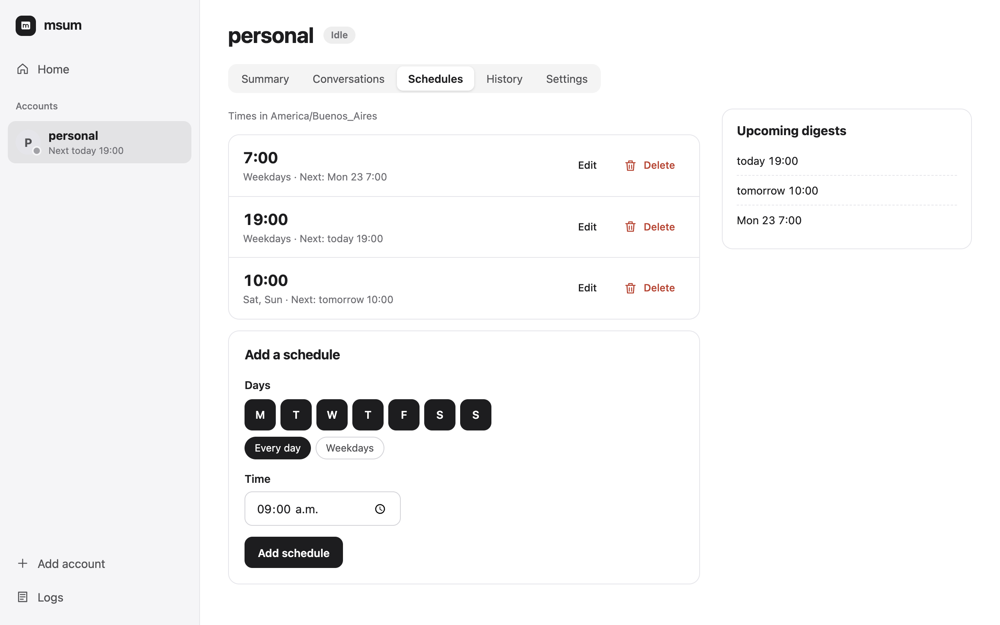
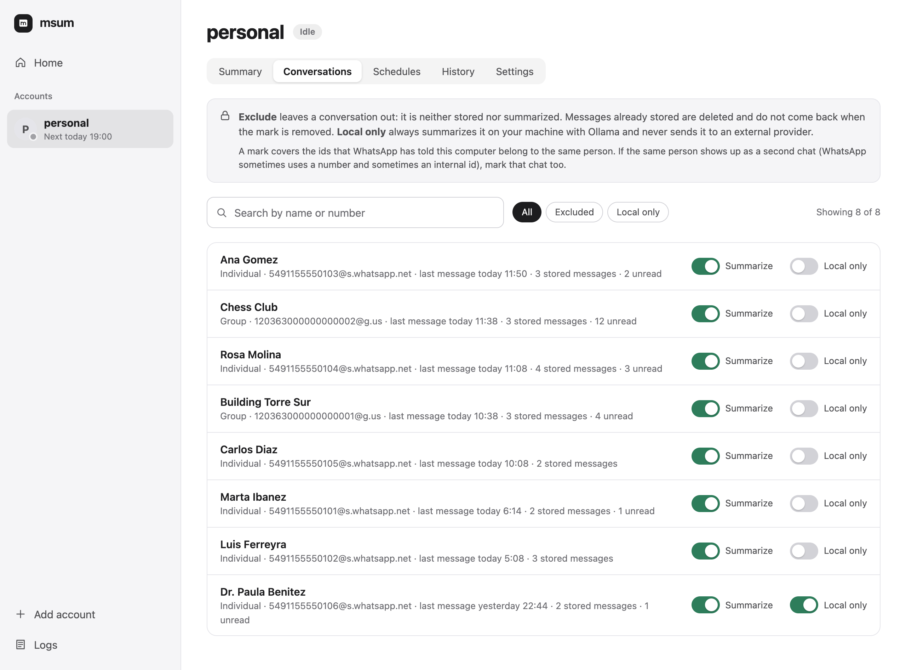
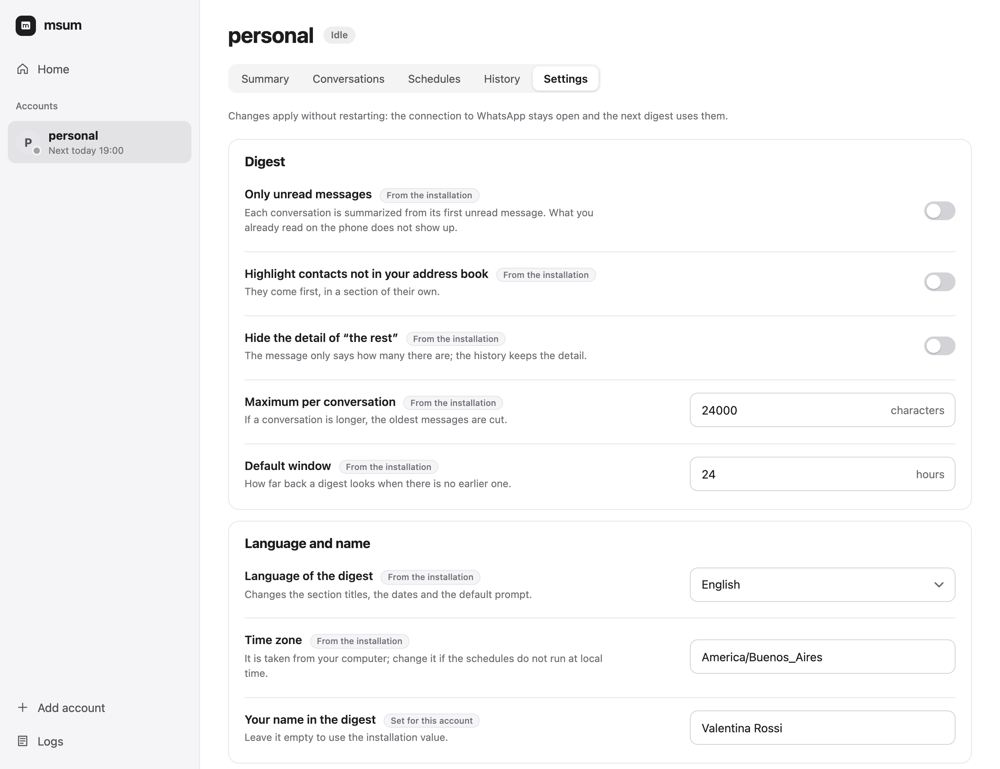
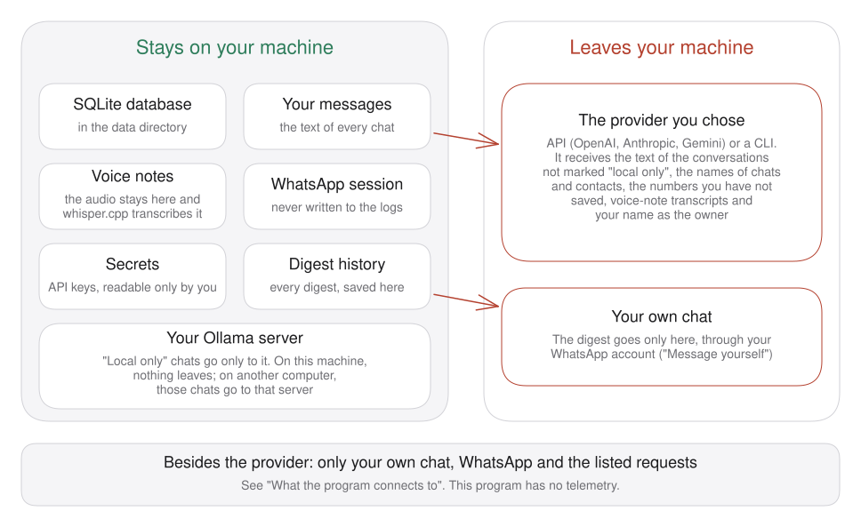

# message-summarize

[Español](README.es.md)

Reads the messages that arrive at your messaging account, summarizes them with the language model of your choice and sends you a periodic digest: which chats need a reply, what is still pending and what you can safely ignore. The first supported platform is **WhatsApp**; the core does not depend on it, so others (Telegram, Slack, email) can be added as new adapters.



*Messages are stored on your machine, an LLM summarizes them on the schedule you set, and the digest comes back only to your own chat.*

**Status:** early development. There is no published release yet (see [Known limitations](#known-limitations)); expect rough edges. The approved requirements are in [docs/requirements.md](docs/requirements.md) (in Spanish) and the work is organized in the phases of the [roadmap](#roadmap).

## What it does

| Stage | What it does |
|---|---|
| **Capture** | Links your account by scanning a QR code from a local web page and keeps it connected without marking you "online", so your phone keeps receiving notifications. Stores messages only on your machine (text, and a text representation of images, audio, documents, polls, etc.). Optional: transcribes audio locally with whisper.cpp; the audio never leaves your machine. No telemetry. |
| **Summarize** | Summarizes each conversation with the LLM of your choice: through an **API** (OpenAI and any compatible API, Anthropic, Gemini), **Ollama** on your machine, or the provider's **CLI** (Claude Code or a generic command), using the plan you already pay for; CLIs run without tools, in an empty directory and with a time limit. You can mark conversations as "local only": only your own Ollama server summarizes them. If `provider.ollama.baseUrl` points to another computer, those chats do leave for that server (see the [providers guide](docs/guides/providers.md#compatible-servers-and-local-only)). |
| **Deliver** | Sends the digest to your own chat ("Message yourself"), organized in sections: need a reply, have pending items, the rest. It is never sent to anyone else, not even to another account of the same installation. |
| **Schedule** | Runs on the schedule you set from the web (for example 9:00 and 18:00 every day), plus "summarize now" and a preview that sends nothing. Handles several accounts in one installation, each with its own data, configuration and schedules. Installs with Docker or natively on macOS, Linux and Windows. |

## Why these technologies

| Technology | What for | Why |
|---|---|---|
| [Baileys](https://github.com/WhiskeySockets/Baileys) | WhatsApp connection | It is an **unofficial** client (see the [warning](#important-warning)); it stays isolated in an adapter, so other platforms do not touch the core. |
| `node:sqlite` | Storage | It ships with Node 22: no native npm module to build. |
| `croner` | Schedules | Schedules live inside the daemon; the program never writes to the OS crontab or scheduler. |
| [whisper.cpp](https://github.com/ggml-org/whisper.cpp) | Audio transcription (optional) | It runs on your machine: the audio is not sent to any service. |
| LLM providers: API, CLI and Ollama | Summarizing each conversation | You choose between paying per use (API), using the plan you already have (CLI without tools) or keeping everything on your machine (Ollama). |
| Svelte 5 + Vite | The local web page | It compiles to static files that the daemon serves; no component library. |

## Important warning

Read this before using message-summarize with your account.

- **WhatsApp may ban your number.** message-summarize connects through [Baileys](https://github.com/WhiskeySockets/Baileys), an **unofficial** client. WhatsApp does not allow unofficial clients and may ban the number that uses them, temporarily or permanently. The project tries to reduce that risk (read-only, no messages to third parties, never marking you online), but cannot eliminate it.
- **The program is read-only.** It reads incoming messages, never replies, never marks you online and never sends anything to third parties. The only message it sends is the digest, to your own chat ("Message yourself").
- **Modifying the program or misusing it raises the chance of a ban.** Changes that send messages to other people, send many messages, automate replies or change how the client connects can get your number banned. If you modify the code, the risk is yours.
- **Your data stays on your machine, except what goes to the LLM you choose.** Unless you use a local model (Ollama) or mark a conversation as "local only", the text of your conversations is sent to the provider you configure, under its terms. Some free plans may use that content to improve their products, including human review.
- **You are responsible** for complying with WhatsApp's terms, your LLM provider's terms and the privacy law that applies to the conversations of third parties (the people who write to you) that you read and summarize.
- **There is no warranty.** The software is provided "as is", as the [license](LICENSE) says. The authors are not liable for a banned number, a leaked conversation or any other damage.

This project is not affiliated with, endorsed by or sponsored by WhatsApp or Meta.

## Quick start

### 1. Prerequisites

- A WhatsApp account and its phone, to scan the QR code (WhatsApp, Settings > Linked devices).
- **Docker** or Docker Desktop, or **Node 22.16 or later** for the native install and the source.
- An LLM provider. There is no default: you choose it in step 4.

  | Provider | What it needs |
  |---|---|
  | [Claude Code](https://claude.com/claude-code) | The session signed in on this machine (`claude`). Uses your plan, no key. |
  | [Ollama](https://ollama.com) | A local server with a model already downloaded. Everything stays on your machine. |
  | OpenAI, Anthropic or Gemini | An API key. |

The program is read-only: it never marks you "online", never replies and never sends anything except the digest, which goes to your own chat. Read the [important warning](#important-warning) first: this uses an unofficial client and your number may be banned.

### 2. Install

**There is no published release yet.** The installers are written and tested as far as a Mac allows, but the first release (v0.1.0) is still to come. Until then, use Docker or the source from a clone of the repository.

| Path | How |
|---|---|
| **Docker** (any system, recommended on Windows) | See below. |
| **macOS and Linux** | `sh packaging/install.sh` |
| **Windows** | The `message-summarize-<version>-win-x64-setup.exe` installer or `.\packaging\install.ps1` |
| **Source** | `npm install`, `npm run build`, `node dist/main/cli.js init` |

**Docker.** With Docker or Docker Desktop installed, from a clone of the repository:

```sh
docker compose -f docker/compose.yaml up -d
docker compose -f docker/compose.yaml exec message-summarize msum open --print   # the address of the web page, with its access token
```

- Data lives in the `msum-data` volume and the container restarts by itself.
- The web page is published only on `127.0.0.1:8787`: do not change it to another address.
- Use `docker compose -f docker/compose.yaml exec` (never `docker compose run`) for commands.
- The `cli` profile (`docker compose -f docker/compose.yaml --profile cli up -d`) uses an image that also ships Claude Code, Gemini CLI and Codex, for those who want a CLI as the provider. The session is started inside the container (see [Using a CLI as a provider](docs/guides/cli-provider.md)). Gemini CLI and Codex are disabled for now.

**macOS and Linux.** `install.sh` needs no administrator permissions and touches nothing outside your home folder. It installs the program (with its own copy of Node.js, verified against the official checksum, if yours is older than 22.16), registers the daemon as a user service and opens the web page.

```sh
sh packaging/install.sh              # from a clone; --help lists the options
sh packaging/install.sh --uninstall  # removes the program, never your data
```

Options: `--no-service`, `--no-open`, `--modify-path`, `--prefix <folder>`, `--tarball <file|url>`, `--dry-run`. It rejects a folder that contains or is inside the data directory.

**Windows.** Two paths, both without administrator permissions: the `message-summarize-<version>-win-x64-setup.exe` installer that will accompany each release (it is not signed yet, so Windows SmartScreen will warn), or `install.ps1`, which does the same as `install.sh` (`.\packaging\install.ps1 -Help`). Uninstalling keeps your data. Windows on ARM: use Docker.

**Source.** After `npm install` and `npm run build`, `node dist/main/cli.js init` (or `msum init` after `npm link`) creates the data directory and `config.json`. What to check in that file is in the [daemon guide](docs/guides/daemon-and-schedules.md#initial-configuration-configjson).

**Where the data is.**

| System | Folder |
|---|---|
| macOS | `~/Library/Application Support/message-summarize` |
| Linux | `~/.local/share/message-summarize` |
| Windows | `%APPDATA%\message-summarize` |
| Any | The folder in `MSUM_DATA_DIR`, if you set it. |

Uninstalling never deletes it; to remove an account's data use `msum unlink`.

**Release checks.** Every release ships a `SHA256SUMS.txt`. The package is not on npm yet: publishing is blocked on purpose until the license of a dependency is resolved (see [License](#license)).

### 3. Open the web and go through the wizard

`msum open` opens the local page already signed in (with Docker, use the address that `msum open --print` prints). The address carries an access token: do not share it.

The first time, on an installation with no linked account, a three-step wizard starts.

**You.** Your name and the account name. The language follows the browser's and the time zone is the browser's; both can be changed later in Settings.



**Summary.** Choose the provider, see what it receives and who gets it, accept if it leaves your machine and press **Test connection**.



**Link.** Read the risk notice and tick the box; then scan the QR code from WhatsApp and wait for the history sync.



When it ends it creates the default schedules, 09:00 and 18:00 every day. You can close it halfway and resume, or skip it. The full detail of the wizard, the page and the agreements is in the [web guide](docs/guides/web-and-accounts.md).

Without the web: `msum link` shows the QR code in the terminal (it also stays as `qr.png` while valid) and `msum daemon` connects the accounts, runs the schedules and delivers each digest. See the [daemon guide](docs/guides/daemon-and-schedules.md).

### 4. Choose and test the provider

Four commands, in this order (add `--account <id>` when there is more than one account):

| Command | What it does |
|---|---|
| `msum provider ls` | Lists each provider: cost, whether your chats leave the machine, whether it is configured and whether it is usable. No network calls. |
| `msum provider use <name> --model <m>` | Chooses the provider and its model, and says which file it wrote. Before enabling one that sends your chats out, it tells you what it receives and asks you to confirm. |
| `msum secret set <name>` | Stores the API key (read from the input, never from an argument). |
| `msum provider test` | ONE real call with a made-up conversation, never your messages. Exit code 0 if it works, 1 if not. |

Usual setups:

| I want to use | Commands |
|---|---|
| Claude Code with your plan | `msum provider use claude-cli`, sign in with `claude`, `msum provider test` |
| Anthropic API | `msum provider use anthropic --model claude-sonnet-5-5`, `msum secret set anthropic`, `msum provider test` |
| OpenAI | `msum provider use openai --model <model>`, `msum secret set openai`, `msum provider test` |
| Gemini | `msum provider use gemini --model <model>`, `msum secret set gemini`, `msum provider test` |
| Ollama, everything on your machine | `ollama pull <model>`, `msum provider use ollama --model <model>`, `msum provider test` |

API keys never go in `config.json`. A second, backup provider is added with `--backup`. More in the [providers guide](docs/guides/providers.md), [using a CLI as a provider](docs/guides/cli-provider.md), [choosing a local model](docs/guides/local-model-ollama.md) and the step-by-step guides for [Gemini](docs/guides/get-google-api-key.md) and [Claude Code](docs/guides/install-claude-and-login.md).

### 5. Schedules and preview

Each account runs its digests on days of the week at a local time, managed with `msum schedule`:

| Command | What it does |
|---|---|
| `msum schedule ls` | Lists them with their id, days, time and next run. |
| `msum schedule add --time 09:00 [--days daily\|weekdays\|weekends\|mon,wed,fri\|mon-fri]` | Adds one (every day if you omit `--days`). |
| `msum schedule rm <id>` | Deletes one. To change a time, delete it and add the new one. |

A running daemon picks up changes in about five seconds. A new account starts with no schedules (the web wizard creates 09:00 and 18:00).

`msum digest --dry-run` generates a digest now and shows it, without saving or sending anything. Without `--dry-run` the digest is queued and delivered by the running daemon. Options: `--hours N`, `--from "YYYY-MM-DD HH:MM"`, `--to "YYYY-MM-DD HH:MM"`. Rules for time zones, missed runs and old configurations are in the [daemon guide](docs/guides/daemon-and-schedules.md#schedules).

### 6. Daily use

The daemon serves the local page at `http://127.0.0.1:8787`; `msum open` opens it.



- **Schedules:** edit them, "summarize now" and a preview that sends nothing.

  

- **Conversations:** list, search and mark each chat as excluded or "local only". Excluding a chat deletes the messages stored so far.

  

- **Settings:** provider, model, keys, name, language and time zone.

  

Other commands:

| Command | What it does |
|---|---|
| `msum status` | Account, last digest, pending deliveries, next runs and the reason for a block. |
| `msum doctor` | Checks Node, permissions, configuration, provider, linking and, if enabled, transcription. |
| `msum accounts` | Lists the accounts (`msum link --account work` creates and links another). |
| `msum retry --account <id>` | Lifts a block caused by a rejected or replaced connection. |
| `msum service install\|uninstall\|status` | Registers only the daemon so it starts with your session (launchd, `systemd --user` or a `Run` entry), without administrator permissions. |
| `msum whisper models\|download <name>` | Models for [audio transcription](docs/guides/transcription.md). |
| `msum import --from <path>` | [Imports from the previous tool](docs/guides/import-previous-tool.md) without scanning the QR code again. |
| `msum unlink` | **Deletes all of the account's data** (messages, audio, history, pending deliveries and the WhatsApp session; the configuration stays) and asks for confirmation. Afterwards, also remove the device on your phone. |

Everything stays on your machine, in the data directory (readable only by your user), except what the LLM provider you chose receives. The command-line texts are in Spanish or English (`language` in `config.json`).

## What the program connects to

Nothing is sent anywhere except what follows. There is no telemetry, and transcription never opens a network connection.

| Destination | When | What is sent |
|---|---|---|
| WhatsApp | With a connected account | Your own connection and the download of audio you receive, if transcription is on. |
| The LLM provider you chose | When summarizing | The text of the conversations that are not local only, with your prompt. With Ollama, the URL you configured; with an API, `api.openai.com` (or your `baseUrl`), `api.anthropic.com` or `generativelanguage.googleapis.com`. |
| Claude Code's servers | With `claude-cli` | The chat text goes to `api.anthropic.com`; the rest is decided by the CLI itself, not by this program (see the guide). |
| The provider's model list | When choosing a model in the wizard or Settings | A request with no chat text. |
| Your Ollama server | `msum ollama pull`, `msum doctor`, the web model picker | The tag or a request for the model list, no chat text. |
| Hugging Face | Only with `msum whisper download` | The request for the model file, with a pinned checksum. |



The host-by-host detail is in [What the program connects to](docs/guides/network-and-privacy.md); what each provider does with your data is in the [providers guide](docs/guides/providers.md#privacy-what-each-provider-does-with-your-data).

## Repository layout

Ports and adapters architecture: dependencies only point inward.

```
src/
  domain/            entities and rules (Conversation, Participant, Message, digest policies)
  application/       use cases; ports/ holds the interfaces (MessageSource, DeliveryChannel, Summarizer, ...)
  infrastructure/    adapters: whatsapp, llm/api, llm/cli, persistence/sqlite, transcription, scheduling, rendering
  interfaces/        cli, http, web
  main/              composition root
test/
  unit/  contract/  golden/  fixtures/
```

`domain/` and `application/` never import from `infrastructure/` or `interfaces/`. A new platform or LLM provider is a new adapter that passes the contract tests of its port. The project rules are in [AGENTS.md](AGENTS.md).

## Troubleshooting

| Symptom | Cause | What to do |
|---|---|---|
| An account is inactive and `msum status` shows a reason | WhatsApp closed the session, rejected the connection (403) or replaced it, or the session belongs to another number. The daemon blocks it (`accounts/<id>/blocked.json`) so it does not reconnect in a loop. | If the connection was rejected or replaced: `msum retry --account <id>` (the web offers to retry). After a rejection, the web makes you wait 30 minutes. |
| The session is no good | Dead session, or closed from the phone. | `msum unlink --account <id>` and then `msum link --account <id>`. Afterwards, also remove the old device on your phone. |
| `msum link` or `msum unlink` rejects the account | The daemon is using it (linked and not blocked). | Stop the daemon first. |
| `digest` or the schedules do not work | No provider is set: `init` writes `"primary": null`. | `msum provider use <name> --model <model>` and `msum provider test`. |
| The API key is missing | The API provider has no stored key. | `msum secret set <provider>` (or the environment variable). `msum doctor` says which one your configuration will use. |
| The Ollama model is not installed | With Ollama, the configured model was not downloaded. | `msum ollama pull <tag>`; `msum ollama recommend` lists the ones that fit your RAM. |
| "this version of X cannot be run without tools" | A CLI whose `--help` does not list every hardening flag is not used (rule RF-49). | Update the CLI (it is checked again), use another provider, or set a backup provider. See [using a CLI as a provider](docs/guides/cli-provider.md). |
| Schedules run at the wrong time in Docker | Without `TZ`, the container uses UTC. | Set `TZ` or `timezone` in the configuration. The web shows the time zone in use next to the schedules. |
| The web does not open, or the port is busy | Another program uses port 8787. | Native: change `web.port` in the installation's `config.json`. Docker: free port 8787 on the host and do not change the published port (`127.0.0.1:8787:8787`): another port answers 403. |
| Two daemons on the same session (WhatsApp disconnects one) | `docker compose run` was used instead of `exec`. | Always use `docker compose -f docker/compose.yaml exec`. |
| Audio shows as "audio not transcribed" | Transcription ships off, or whisper, ffmpeg or the model is missing. An audio that failed is not retried. | `msum doctor` says what is missing. See the [transcription guide](docs/guides/transcription.md). |

## Known limitations

- There is no published release yet: the first one (v0.1.0) is still to come.
- The Windows installer has never run on a real Windows machine, and is not signed yet. On Windows ARM, use Docker.
- A dependency, `libsignal` (which Baileys brings), is licensed GPL-3.0 and how it reconciles with the MIT license is still to be resolved (see [License](#license)).
- Publishing to npm is blocked on purpose until that is resolved.
- Gemini CLI and Codex are disabled: they document no verifiable way to turn their tools off (see [using a CLI as a provider](docs/guides/cli-provider.md)). The generic CLI can run them, at your own risk.
- Only Spanish and English texts exist.
- By default the web listens only on this machine; `web.host` can change that, which is an explicit choice.

## Guides

The reference detail is in [docs/guides](docs/guides/README.md) (English) and [docs/guias](docs/guias/README.md) (Spanish):

| Guide | What it explains |
|---|---|
| [Providers](docs/guides/providers.md) | Choosing and testing the LLM provider, API keys and each one's privacy. |
| [A CLI as a provider](docs/guides/cli-provider.md) | The "no tools" rule and the generic CLI. |
| [Transcription](docs/guides/transcription.md) | whisper.cpp, options and limits. |
| [Local model (Ollama)](docs/guides/local-model-ollama.md) | Candidates, evaluation and the `msum ollama` commands. |
| [Import the previous tool](docs/guides/import-previous-tool.md) | `msum import`. |
| [Network and privacy](docs/guides/network-and-privacy.md) | Every network destination. |
| [The web and accounts](docs/guides/web-and-accounts.md) | The page, the wizard, exclusions and agreements. |
| [The daemon and schedules](docs/guides/daemon-and-schedules.md) | `config.json`, blocks, several accounts and `msum schedule`. |
| [Google API key (Gemini)](docs/guides/get-google-api-key.md) | Step by step. |
| [Installing Claude Code and signing in](docs/guides/install-claude-and-login.md) | Step by step. |

## Roadmap

| Phase | Goal |
|---|---|
| 0 | Reference tests (golden files) that capture the behavior of the author's current personal tool, using made-up conversations |
| 1 | Domain and digest generation; WhatsApp source and delivery to your own chat |
| 2 | Daemon, schedules, multiple accounts and import from the personal tool |
| 3 | LLM providers (API and CLI), fallback provider, local-only conversations, whisper.cpp transcription and `doctor` |
| 4 | Local web: setup wizard, QR linking, dashboard, settings, history and logs |
| 5 | Packaging: Docker image, installers for macOS, Linux and Windows, system service |
| 6 | CI, license checks, documentation and the first release (v0.1.0) |

## License

[MIT](LICENSE) for this project's own code. One dependency, `libsignal` (brought in by Baileys, the WhatsApp client), is licensed GPL-3.0; how that fits with the MIT license has to be settled before the first release (the options are to replace it, isolate it or relicense; nothing is decided yet), and `npm run check:licenses` lists it as a named exception until then. Publishing to npm is blocked on purpose until that decision is made. The full list of dependencies and their licenses is in [THIRD_PARTY_NOTICES.md](THIRD_PARTY_NOTICES.md).

## Contributing and security

- [CONTRIBUTING.md](.github/CONTRIBUTING.md): how to set up the repository, the checks and the rules for changes.
- [SECURITY.md](.github/SECURITY.md): how to report a vulnerability privately.
- [THIRD_PARTY_NOTICES.md](THIRD_PARTY_NOTICES.md): the dependencies and their licenses.
