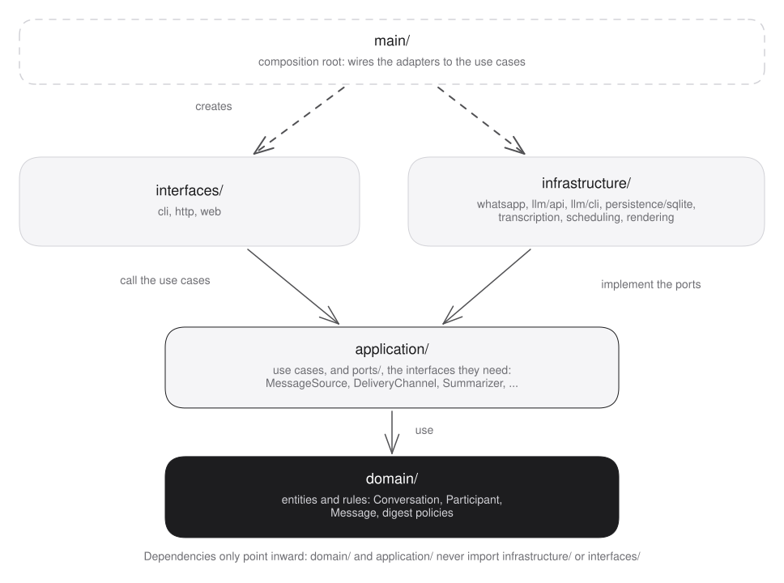
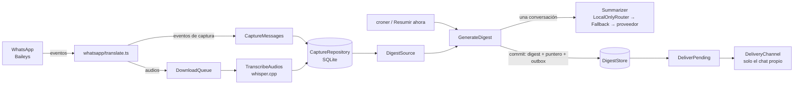

# message-summarize: arquitectura

Cómo está construido el producto hoy, en el código de `main`. Qué hace está en [requirements.md](requirements.md) y por qué se decidió cada cosa, en [decisiones.md](decisiones.md). Si este documento y el código no coinciden, manda el código y se corrige este documento en el mismo PR.

Última revisión: 2026-11-25, sobre la versión `0.1.0-rc1`, con `src/main/` ya ordenado por carpetas.

## 1. Capas

Puertos y adaptadores. Las dependencias apuntan solo hacia adentro.

| Capa | Qué tiene | Puede importar |
|---|---|---|
| `src/domain/` | Entidades (`Conversation`, `Participant`, `Message`) y reglas puras del digest: ventana y puntero, no leídos, masivos propios, deduplicación, secciones, truncado, exclusiones, horarios, ajustes, selección y textos de Ask | Solo `domain/` |
| `src/application/` | Casos de uso (`CaptureMessages`, `TranscribeAudios`, descarga de audios, `GenerateDigest`, `DeliverPending`, `AskChats`) y `ports/`, las interfaces que necesitan | `domain/` y `application/` |
| `src/infrastructure/` | Adaptadores: `whatsapp/` (Baileys), `llm/api/`, `llm/cli/`, Ollama, `persistence/sqlite/`, `transcription/` (whisper.cpp), `scheduling/` (croner), `rendering/`, `service/` (launchd, systemd, clave `Run` de Windows), `secrets/`, `i18n/`, `legacy/` (importar la herramienta anterior) | Todo menos `interfaces/` y `main/` |
| `src/interfaces/` | `cli/` (parseo de argumentos), `http/` (router, SSE, archivos estáticos) y `web/` (Svelte 5) | Lo que exponga `main/` por tipos |
| `src/main/` | Raíz de composición y lo que la rodea: configuración, daemon, comandos de la CLI, rutas de la web y el cableado de todo lo anterior. Una carpeta por área, ver la sección 2 | Todo |

La regla para `domain/` y `application/` la verifica `test/unit/architecture.test.ts`: ni Node, ni paquetes de npm, ni imports hacia afuera. El resto de las direcciones es convención y la revisa el agente `reviewer`.

### `src/main/` por dentro

Arriba quedan solo los archivos que arman el programa; el resto está en una carpeta por área. Un archivo no repite en su nombre lo que ya dice su carpeta (`web/models.ts`, no `web/web-models.ts`).

| Carpeta | Qué tiene |
|---|---|
| `main/` | La raíz de composición: `cli.ts` (el ejecutable, `dist/main/cli.js`), `app.ts` (despacha los comandos), `context.ts` (lo que recibe cada comando), `runtime.ts` (arma los casos de uso y adaptadores de una cuenta) y `whatsapp.ts` (la conexión como la usan el daemon y los comandos) |
| `main/commands/` | Un archivo por comando de la CLI y `account-command.ts`, lo que comparten los que trabajan sobre una cuenta |
| `main/config/` | La configuración: lectura y validación de `config.json` (`config.ts`), escritura atómica (`config-writer.ts`, `atomic-write.ts`), proveedores y su prueba, consentimientos (RNF-02), horarios de la configuración y alias de privacidad |
| `main/installation/` | El directorio de datos: rutas (`paths.ts`), registro de cuentas (`accounts.ts`), lo que se sabe de cada una (`account-*.ts`), las marcas `blocked.json` y `state.json`, reintentar una cuenta bloqueada y el lock del daemon |
| `main/daemon/` | `Daemon` (`daemon.ts`, una cuenta), `DaemonHost` (`host.ts`, todas las cuentas) y `run-digest.ts`, que corre un digest de una cuenta |
| `main/link/` | Vincular una cuenta: el flujo (`flow.ts`), su lock, el QR y la captura que cuenta lo que llega mientras se sincroniza |
| `main/web/` | El servidor (`server.ts`), una ruta por pantalla (`accounts.ts`, `conversations.ts`, `settings.ts`...), `routes.ts` con lo que comparten, y los servicios que solo usa la web: `ask-service.ts` (Ask) y `preview.ts` (vista previa) |
| `main/logging/` | El logger con lista de campos permitidos (RNF-04, RNF-12), el archivo de log y el buffer que lee la web |
| `main/import/` | Importar la configuración y los datos de la herramienta anterior |
| `main/system/` | Lo que depende del sistema operativo o del paquete: versión, ruta de node, abrir el navegador, sondas de comandos y señales del proceso |

Los tests de `test/unit/main/` siguen las mismas carpetas. Los que manejan la CLI entera o cruzan varias áreas (por ejemplo `multi-account.test.ts` o los `transcription-*.test.ts`) quedan arriba.

## 2. Procesos

Hay un solo proceso largo por instalación, el **daemon** (`msum daemon`), protegido por un archivo de lock.

- **`DaemonHost`** (`src/main/daemon/host.ts`) lleva todas las cuentas: cada 5 segundos reconcilia la lista de cuentas con las unidades que corren, arranca las cuentas vinculadas, deja quietas las bloqueadas y vincula cuentas nuevas desde la web.
- **`Daemon`** (`src/main/daemon/daemon.ts`) es la unidad de UNA cuenta: conexión, captura, horarios con croner, entrega y recuperación de ejecuciones perdidas. Ante un estado terminal (sesión cerrada, 403, reemplazada) frena la conexión, escribe `blocked.json` y queda quieta a propósito, para no reconectar en loop (RNF-17).
- **La web** la sirve el mismo daemon en `127.0.0.1` con token (RNF-03): `src/main/web/server.ts` arma el servidor, el resto de `src/main/web/` son las rutas por pantalla y `src/interfaces/http/` el router y el SSE.
- **La CLI** (`src/main/cli.ts`, `src/main/commands/`) corre comandos cortos. Los que tocan una cuenta en uso (`link`, `unlink`, `digest`) se coordinan con el daemon por archivos de lock y por el compare-and-set del puntero en la base.

## 3. Flujos

| Flujo | Entra por | Caso de uso | Puertos | Adaptadores |
|---|---|---|---|---|
| Captura (RF-10 a RF-19) | `infrastructure/whatsapp/translate.ts`, que traduce los eventos de Baileys | `CaptureMessages` (`application/capture-messages.ts`, eventos en `capture-events.ts`) | `CaptureRepository` | `SqliteCaptureRepository` |
| Audios (RF-15, RF-20 a RF-23) | El adaptador encola cada audio | Descarga en `download-audios.ts`, transcripción en `TranscribeAudios` con un pool de workers | `DownloadQueue`, `AudioDownloader`, `Transcriber`, `TranscriptionStore` | `whatsapp/media.ts`, `WhisperCppTranscriber`, `SqliteTranscriptionStore` |
| Digest (RF-30 a RF-39) | Un horario, "Resumir ahora", la vista previa o `msum digest` (`main/daemon/run-digest.ts`) | `GenerateDigest` | `DigestSource`, `Summarizer`, `DigestStore`, `Clock`, renderers de `ports/rendering.ts` | `SqliteDigestSource`, `composeSummarizer`, `rendering/`, `SqliteDigestStore` |
| Entrega (RF-50 a RF-52) | Después de cada commit y cada `sweepMs` mientras hay conexión | `DeliverPending` | `OutboxRepository`, `DeliveryChannel` | `SqliteOutboxRepository`, `WhatsAppSelfChatDelivery` |
| Ask (RF-76) | `POST /api/accounts/:id/ask` (`main/web/ask.ts`, `main/web/ask-service.ts`) | `AskChats`, envuelto por `AskService` (historial, una consulta a la vez, envío al chat propio) | `DigestSource`, `Answerer`, `AskHistory`, `OwnChatQueue` | `SqliteDigestSource`, `composeAnswerer`, `SqliteAskHistory`, `SqliteOutboxRepository` |
| Horarios (RF-60 a RF-66) | `Daemon` | Sin caso de uso propio: la regla está en `domain/schedule.ts` | Ninguno | `CronerScheduler`, `SqliteScheduleRepository` |
| Servicio del sistema (RF-80) | `msum service` | Sin caso de uso propio | `ServiceInstaller` | `LaunchdInstaller`, `SystemdInstaller`, `WindowsRunKeyInstaller` |

La lectura de mensajes no es un puerto: cada plataforma tiene un adaptador que traduce sus eventos a los de `capture-events.ts` (decisión 15). Una plataforma nueva agrega su traductor y, si entrega, su `DeliveryChannel`.

## 4. Proveedores de LLM

Todos implementan `Summarizer` (salida JSON validada contra `summary-schema.ts`) y, salvo `CliSummarizer`, también `Answerer` (texto libre, para Ask).

- **Por API:** `OpenAiCompatibleSummarizer` (OpenAI y cualquier API compatible), `AnthropicSummarizer`, `GeminiSummarizer`, `OllamaSummarizer`.
- **Por CLI:** `ClaudeCliSummarizer`, `GenericCliSummarizer` y `DisabledCliSummarizer` para los presets apagados. Todas corren con `llm/cli/run-process.ts`: sin herramientas, sin MCP, sin sesión, en un directorio temporal vacío y con tiempo máximo (RF-49).
- **Composición:** `composeSummarizer` arma siempre `LocalOnlyRouter` por fuera del `FallbackSummarizer`, así una conversación "solo local" nunca llega a un proveedor externo, ni siquiera por el respaldo (RF-43). No se arma a mano.

## 5. Datos en disco

Todo vive bajo el directorio de datos (`MSUM_DATA_DIR`, ver `src/main/installation/paths.ts`), con permisos 0700 y 0600.

| Ruta | Qué guarda |
|---|---|
| `config.json`, `secrets.json` | Configuración y claves de API de la instalación |
| `app.db` | Cuentas, horarios, estado del asistente y consentimientos. Migraciones propias |
| `web-token`, `web-session`, `web.json` | Token de la web, secreto de las cookies y dirección donde escucha el daemon |
| `daemon.pid` | Lock del daemon: uno por instalación |
| `models/` | Modelos de whisper, compartidos |
| `accounts/<id>/db.sqlite` | Mensajes, no leídos, transcripciones, digests, outbox, historial de ejecuciones y de Ask. SQLite en modo WAL con `schema_version` (RNF-08, RNF-16) |
| `accounts/<id>/auth/` | Sesión de WhatsApp. Nunca se loguea (RNF-04) |
| `accounts/<id>/media/` | Audios esperando transcripción, hasta `transcription.maxMediaMb` |
| `accounts/<id>/config.json`, `secrets.json`, `state.json`, `blocked.json`, `link.lock` | Ajustes y claves que pisan los de la instalación, estado para la web, marca de bloqueo y lock de un `msum link` en curso |

Borrar `accounts/<id>/` borra la cuenta entera (RF-03).

## 6. Dónde está cada área

| Requerimientos | Código |
|---|---|
| RF-01 a RF-07, cuentas y vinculación | `main/daemon/host.ts`, `main/link/`, `main/installation/accounts.ts`, `infrastructure/whatsapp/connection.ts`, `account-binding.ts`, `infrastructure/legacy/`, `main/import/` |
| RF-10 a RF-19, captura | `infrastructure/whatsapp/` (`translate.ts`, `content.ts`, `details.ts`, `raw.ts`), `application/capture-*.ts`, `persistence/sqlite/capture-*.ts` |
| RF-20 a RF-23, transcripción | `application/download-audios.ts`, `transcribe-audios.ts`, `infrastructure/transcription/` |
| RF-30 a RF-39, digest | `domain/` (`window.ts`, `unread.ts`, `mass.ts`, `dedupe.ts`, `sections.ts`, `truncate.ts`, `prompt.ts`), `application/generate-digest.ts`, `infrastructure/rendering/` |
| RF-40 a RF-49, proveedores | `infrastructure/llm/`, `main/config/providers.ts`, `main/config/provider-test.ts`, `main/config/consent.ts` |
| RF-50 a RF-53, entrega | `application/deliver-pending.ts`, `infrastructure/whatsapp/self-chat-delivery.ts`, `persistence/sqlite/outbox.ts` |
| RF-60 a RF-66, horarios | `main/daemon/daemon.ts`, `main/config/schedules.ts`, `domain/schedule.ts`, `infrastructure/scheduling/` |
| RF-70 a RF-76, web | `interfaces/web/`, `interfaces/http/`, `main/web/`, `application/ask-chats.ts` |
| RF-80 a RF-82, CLI | `interfaces/cli/`, `main/cli.ts`, `main/commands/` |
| RNF-01, RNF-04, privacidad | `test/support/network-guard.ts`, `main/logging/logger.ts`, `infrastructure/llm/api/redact.ts` |
| RNF-05 a RNF-07, instalación | `docker/`, `packaging/`, `infrastructure/service/` |

Qué test cubre un requerimiento se encuentra buscando su ID en `test/`.

## 7. Tests

| Carpeta | Qué prueba |
|---|---|
| `test/unit/` | Cada módulo, con la misma estructura que `src/` |
| `test/contract/` | Una suite por puerto (`*.contract.ts`) que corre contra cada adaptador (`*.test.ts`) |
| `test/golden/` | Escenarios inventados con la salida congelada de la herramienta anterior (OBJ-3) |
| `test/eval/` | Evaluación de modelos de Ollama contra los golden (RF-45). No corre en CI |
| `test/support/` | Fakes, arneses y la guardia de red que hace fallar un test que llama a la red sin declararlo |

`npm run test:mutation` corre StrykerJS sobre `domain/` y `application/`.

## 8. Deuda conocida

- **`DaemonHost` es grande:** `main/daemon/host.ts` tiene unas 1 650 líneas: reconciliación de cuentas, vinculación desde la web, reintentos y alias de privacidad. La reorganización en carpetas de `src/main/` no lo partió, para no mezclar un cambio de lugar con uno de código.
- **`main/config/config.ts`** tiene unas 1 100 líneas con el esquema y la validación de toda la configuración.
- **Votos de encuestas:** llegan cifrados y se guardan tal cual (`poll_votes`); descifrarlos queda pendiente.
- **Confirmación de entrega:** un envío cuenta como hecho cuando se escribe en el socket, no cuando el servidor lo recibe (ver `deliver-pending.ts`).
