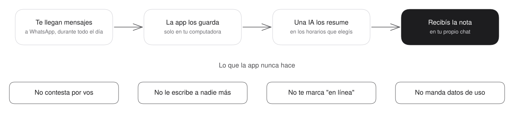
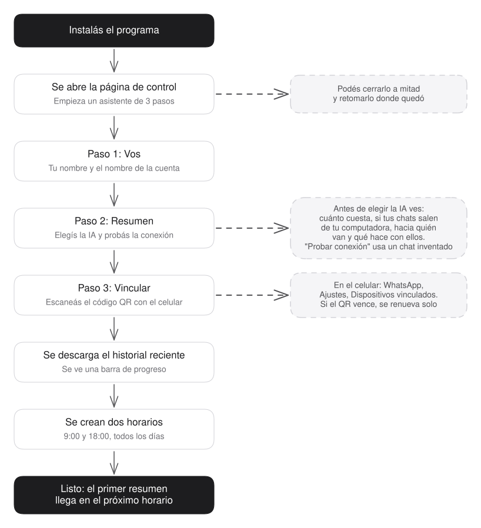
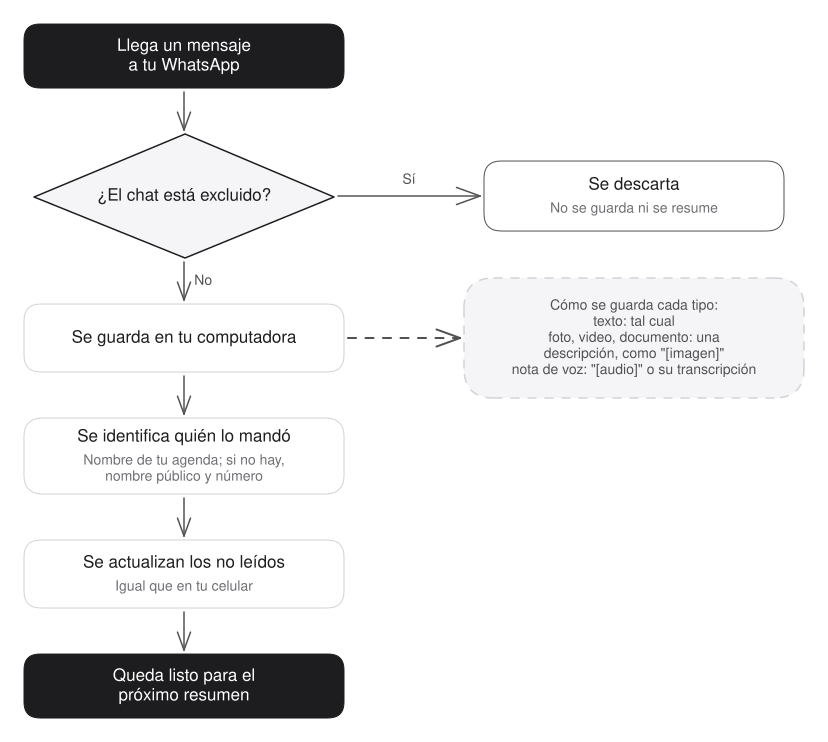
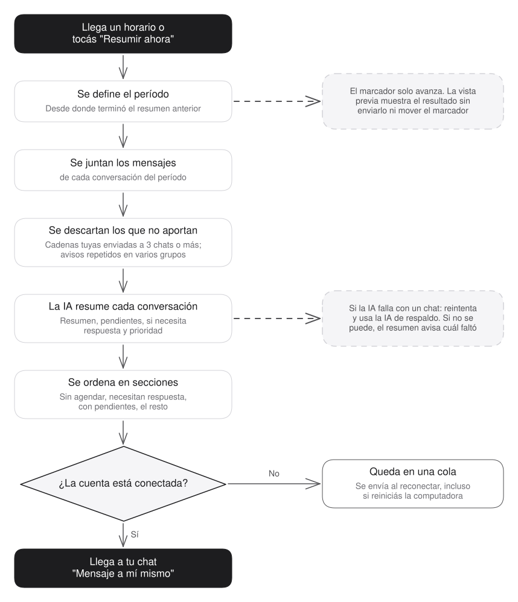
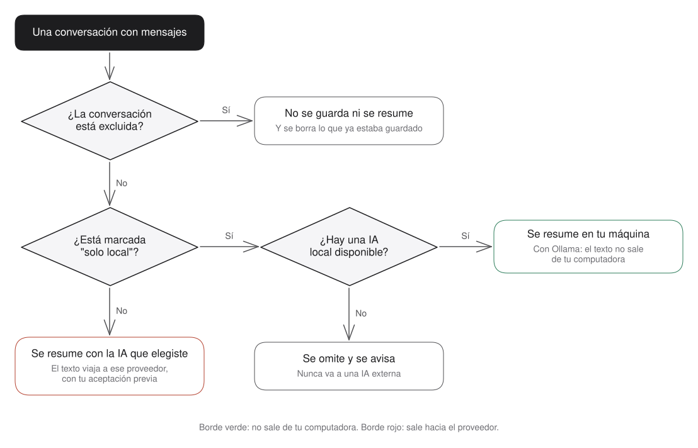
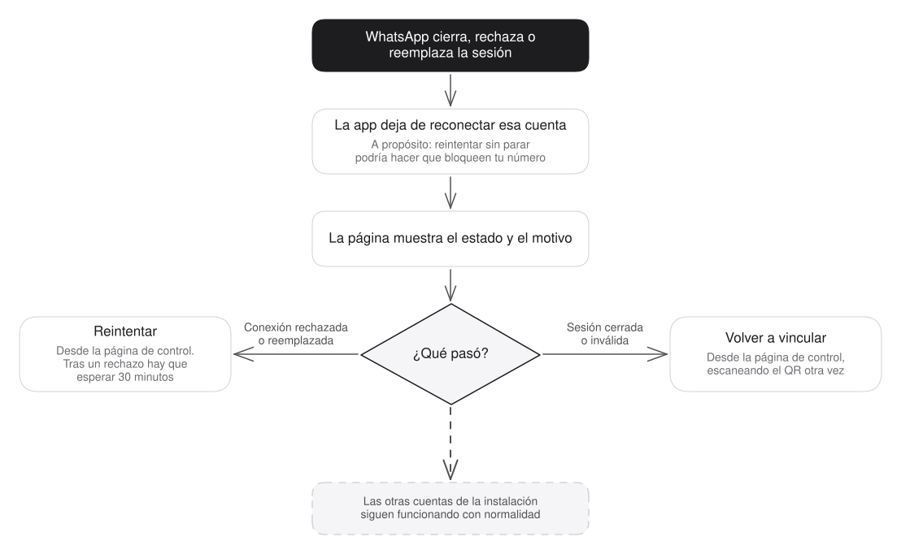

# Cómo funciona message-summarize, explicado sin tecnicismos

Este documento es para cualquier persona, sin importar si sabe de programación. Cuenta qué problema resuelve la aplicación y qué pasa, paso a paso, desde que te llega un mensaje hasta que recibís el resumen. Volver al [README](../../README.es.md) · [Índice de guías](README.md).

## El problema

Si recibís muchos mensajes por día (chats de trabajo, grupos de la familia, la escuela, clientes), te pasan tres cosas:

- No sabés **a cuáles tenés que contestar** y cuáles podés dejar para después.
- Se te **pierden pendientes** que alguien te pidió entre veinte mensajes de un grupo.
- Perdés mucho tiempo **abriendo chat por chat** para descubrir que no había nada importante.

## Qué hace la aplicación

Es como tener un asistente que, mientras no mirás el celular, **lee todo lo que te llegó y te deja una nota corta** con lo que importa:

> "Ana te pregunta si podés el jueves: **necesita respuesta**. En el grupo del colegio avisan que el viernes no hay clases: **solo informativo**. Pedro te mandó el presupuesto: **pendiente de revisar**."

Esa nota se llama **resumen** (en el código y las guías técnicas, *digest*). Te llega a tu propio chat de WhatsApp, el que se llama "Mensaje a mí mismo", en los horarios que vos elijas (por ejemplo, a las 9:00 y a las 18:00).

## Qué NO hace

Estas garantías son parte del diseño, no un detalle:

- **No contesta mensajes por vos.** Solo lee.
- **No le escribe a nadie más.** El único mensaje que envía es el resumen, y va únicamente a tu propio chat. Ni siquiera a otra cuenta tuya instalada en el mismo programa.
- **No te marca "en línea"**, así que el celular sigue sonando con las notificaciones de siempre.
- **No manda estadísticas ni datos a nadie.** No tiene telemetría.
- **No te muestra tus chats en internet.** La página de control solo se abre en la computadora donde está instalado el programa.

## Las piezas, con una analogía

Imaginá una oficina chica:

| Pieza | Analogía | Qué es en la realidad |
|---|---|---|
| **El programa que corre de fondo** | El encargado que nunca se va de la oficina | Se llama *daemon*. Es lo único que queda encendido: mantiene la conexión con WhatsApp, guarda mensajes, mira el reloj y entrega los resúmenes |
| **Tu cuenta de WhatsApp** | La puerta por donde entra el correo | Se conecta como un "dispositivo vinculado", igual que WhatsApp Web |
| **La base de datos local** | El archivo de la oficina | Todos los mensajes se guardan **solo en tu computadora** |
| **La IA (el "proveedor")** | El empleado que lee y redacta | Un modelo de lenguaje: Claude, ChatGPT, Gemini u Ollama (que corre en tu propia máquina). Lo elegís vos |
| **Los horarios** | El despertador | Reglas como "todos los días a las 9:00 y a las 18:00" |
| **La página web local** | El tablero de control | Una página que se abre en tu navegador para configurar todo |

## Flujo 1: la primera vez (instalar y dejarlo andando)

Todo el recorrido está pensado para que alguien sin conocimientos técnicos lo complete en unos 10 minutos.

Detalles que conviene saber:

- **Elegir la IA es obligatorio y es tu decisión.** No hay una por defecto. La pantalla te explica cuánto cuesta cada opción, si tus chats salen de tu computadora, hacia quién van y qué hace esa empresa con ellos.
- **"Probar conexión"** hace una llamada real, pero con una conversación inventada. Nunca usa tus mensajes para probar.
- **El QR** es el mismo mecanismo que usás para abrir WhatsApp Web: desde el celular, *Ajustes → Dispositivos vinculados*. Si vence, se renueva solo.
- Si cerrás el asistente a mitad de camino, **podés retomarlo** donde quedó.

## Flujo 2: el día a día, mientras no mirás el celular

Cada mensaje que llega recorre este camino de manera automática:

Cosas que la app tiene en cuenta:

- **Ediciones.** Si alguien edita un mensaje, el resumen usa la versión nueva.
- **Leídos y no leídos.** Si leés un chat desde el celular, la app se entera. Podés pedir que el resumen incluya **solo lo que no leíste**.
- **Cortes de internet.** Si se cae la conexión, la app vuelve sola y recupera lo que WhatsApp reenvía.
- **Notas de voz (opcional).** Se pueden convertir a texto **dentro de tu computadora**. El audio nunca se envía a ningún servicio.

## Flujo 3: cómo se arma un resumen

Esto pasa cada vez que llega un horario, o cuando tocás **"Resumir ahora"**:

### Cómo queda ordenado el resumen

1. Contactos que **no tenés agendados** (opcional, para que no se te pasen).
2. Chats que **necesitan respuesta**.
3. Chats **con pendientes**.
4. **El resto** (lo que podés ignorar). Si querés, el mensaje muestra solo cuántos son, y el detalle queda guardado en el historial.

Dentro de cada sección, primero van los de prioridad más alta y después los que tienen más mensajes.

### "¿Desde cuándo?": el marcador

Cada resumen **arranca justo donde terminó el anterior**, así nunca se repiten mensajes ni se saltean. Es como un señalador de libro que solo avanza.

- La **vista previa** muestra cómo quedaría un resumen **sin enviarlo y sin mover el señalador**.
- Si es la primera vez y no hay señalador, cubre las últimas 24 horas (configurable).
- También se puede pedir un período puntual, por ejemplo "las últimas 6 horas".

### Qué pasa cuando algo sale mal

La app está pensada para **no frenarse por un solo problema**:

| Situación | Qué hace la app |
|---|---|
| La IA falla con una conversación | Reintenta y, si configuraste una IA de respaldo, usa esa. El resumen indica cuáles se hicieron con el respaldo |
| La IA devuelve una respuesta ilegible | La trata como falla de esa conversación, no corta todo el resumen |
| El plan gratuito de la IA se quedó sin cupo | Espera el tiempo que indica el proveedor y reintenta. Si no alcanza, entrega lo que pudo y avisa qué chats faltaron |
| Una conversación es larguísima | Recorta los mensajes más viejos y lo indica |
| Tu computadora estaba apagada a la hora del resumen | Al encenderse, genera **un** resumen pendiente (no uno por cada horario perdido) |
| WhatsApp está desconectado cuando el resumen está listo | Queda en una cola y se envía apenas se reconecte, incluso si reiniciás la computadora |
| Pedís un resumen mientras otro se está armando | Espera o te avisa; nunca corren dos a la vez para la misma cuenta |

## Flujo 4: tu privacidad, paso a paso

Es el punto más sensible, porque en tus chats hay conversaciones de otras personas. Este diagrama muestra adónde va cada conversación:

Dónde queda cada cosa: los mensajes, audios, transcripciones y resúmenes **solo en tu computadora**; el texto de las conversaciones, al momento de resumir, **va a la IA que elegiste**; y con Ollama (una IA instalada en tu propia máquina) **no sale nada**.

Las herramientas que tenés para controlarlo:

- **Excluir un chat:** la app no lo guarda ni lo resume. Los mensajes que ya tenía guardados de ese chat se borran.
- **Marcar un chat como "solo local":** se resume únicamente con una IA que corre en tu máquina. Si no hay ninguna disponible, ese chat **se omite** y se avisa. **Nunca** se envía a una IA externa.
- **Consentimiento explícito:** antes de usar una IA externa, la app te muestra qué datos recibe y a quién, y te pide aceptar. Queda registrado.
- **Acceso a la página:** solo desde tu computadora y con una clave de acceso (token) que se genera al instalar.
- **Claves y sesión de WhatsApp:** se guardan con permisos de archivo restringidos y nunca aparecen en los registros de actividad.
- **Las IA que se usan desde su programa de línea de comandos** (como Claude Code) corren **sin herramientas**, en una carpeta vacía y con tiempo máximo, porque el texto de un chat lo escriben terceros y podría contener instrucciones maliciosas.

## Flujo 5: qué podés hacer desde la página de control

Se abre con el comando `msum open` y tiene estas secciones:

| Sección | Para qué sirve |
|---|---|
| **Resumen** (inicio) | Ver si cada cuenta está conectada, cuándo fue el último resumen y cuándo es el próximo. Botones "Resumir ahora" y "Vista previa" |
| **Conversaciones** | Buscar chats y marcarlos como excluidos o "solo local" |
| **Horarios** | Crear, cambiar o borrar horarios. Los cambios se aplican al instante |
| **Historial** | Ver los resúmenes anteriores completos, con qué IA se hicieron y si hubo errores |
| **Ajustes** | Cambiar IA, modelo, claves, nombre, idioma, zona horaria y el texto de las instrucciones que se le dan a la IA |

También hay una vista de **registros** (qué hizo el programa, sin mensajes ni nombres) para cuando algo no anda.

## Flujo 6: cuando WhatsApp corta la sesión

A veces WhatsApp cierra la sesión (por ejemplo, si la quitás desde el celular) o rechaza la conexión. En ese caso:

1. La app **deja de intentar** conectarse con esa cuenta, a propósito: reintentar sin parar podría hacer que bloqueen tu número.
2. La página te muestra el estado y el motivo.
3. Vos decidís: **reintentar** (después de un rechazo, la página te hace esperar 30 minutos) o **volver a vincular** escaneando el QR otra vez.

Si tenés varias cuentas, un problema en una **no afecta a las otras**.

## Varias cuentas

Una misma instalación puede manejar varias cuentas de WhatsApp (por ejemplo, la personal y la de trabajo). Cada una tiene sus propios mensajes, horarios, configuración y resúmenes, y **cada resumen llega solo a la cuenta que se resumió**. Borrar una cuenta elimina únicamente sus datos.

## Un riesgo que tenés que conocer

La aplicación se conecta a WhatsApp con un cliente **no oficial**. WhatsApp no permite clientes no oficiales y **podría bloquear el número** de forma temporal o permanente. El proyecto reduce ese riesgo (solo lee, no escribe a terceros, no se marca en línea), pero no lo elimina. Cualquier cambio que haga que el programa mande mensajes a otras personas, o cambie cómo se conecta, aumenta ese riesgo. El aviso completo está en el [README](../../README.es.md#aviso-importante).

## Qué necesitás para usarla

- Una cuenta de WhatsApp y el celular a mano para escanear el QR.
- Una computadora que quede **encendida** (los horarios solo se cumplen si está prendida y el programa corriendo; si necesitás garantía total, hace falta un servidor).
- Una IA para resumir: puede ser un plan que ya pagás (Claude), una clave de un servicio (OpenAI, Anthropic, Gemini; Gemini tiene un plan gratuito, con advertencias de privacidad) o Ollama, que es gratis y corre en tu máquina.

## Glosario rápido

| Palabra | Qué significa |
|---|---|
| **Resumen / digest** | La nota con lo importante de todos tus chats en un período |
| **Cuenta** | Un número de WhatsApp vinculado |
| **Conversación** | Un chat individual o un grupo |
| **Proveedor** | La IA que lee y resume |
| **Horario** | Una regla del tipo "lunes a viernes a las 9:00" |
| **Daemon** | El programa que queda corriendo de fondo |
| **Solo local** | Un chat que se resume únicamente con una IA instalada en tu máquina |
| **Vista previa** | Un resumen de prueba que no se envía ni se registra |

---

Para el detalle técnico de cada parte: [proveedores](proveedores.md) · [web y cuentas](web-y-cuentas.md) · [daemon y horarios](demonio-y-horarios.md) · [red y privacidad](red-y-privacidad.md) · [requerimientos](../requirements.md).
