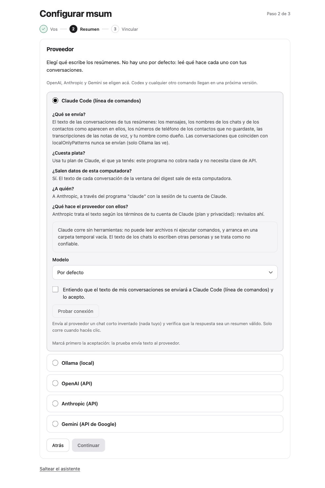

# Instalar Claude Code e iniciar sesión (para usar "Claude (línea de comandos)" en msum)

msum puede pedirle los resúmenes al programa `claude` (Claude Code), usando el plan de Claude que ya tenés. No necesita clave de API y msum no cobra nada.

## Qué se envía y a quién

- El texto de cada conversación sale de tu computadora y va a Anthropic, con tu sesión de Claude.
- Anthropic trata el texto según los términos de tu cuenta de Claude (plan y privacidad): revisalos ahí.
- Las conversaciones marcadas como "solo local" nunca se envían a un proveedor externo, y este lo es.
- Claude corre sin herramientas: no puede leer archivos ni ejecutar comandos.
- Costos: necesitás una cuenta de Claude (Pro, Max, Team o Enterprise) o una cuenta de la Consola de Claude, según la documentación oficial. Mirá los planes y precios vigentes en <https://claude.com/pricing>.

## Paso a paso

1. **Abrí una terminal** (la ventana donde se escriben comandos).
   - macOS: apretá `Cmd + Espacio`, escribí `Terminal` y `Enter`.
   - Windows: apretá `Win + X` y elegí **Windows PowerShell** (o **Terminal**). Tiene que verse `PS C:\...` al principio de la línea.
   - Linux: `Ctrl + Alt + T`, o buscá "Terminal" en el menú de aplicaciones.
2. **Instalá Claude Code**: copiá la línea de tu sistema, pegala y apretá `Enter`. No muestra avance: esperá hasta que diga "Claude Code successfully installed!".
   - macOS y Linux: `curl -fsSL https://claude.ai/install.sh | bash`
   - Windows (PowerShell): `irm https://claude.ai/install.ps1 | iex`
   - Windows (CMD, si no tenés PowerShell): `curl -fsSL https://claude.ai/install.cmd -o install.cmd && install.cmd && del install.cmd`
   - Alternativas oficiales: en macOS, `brew install --cask claude-code`; en Windows, `winget install Anthropic.ClaudeCode`.
3. **Comprobá que quedó instalado**: abrí una terminal nueva y escribí `claude --version`. Tiene que mostrar un número de versión.
4. **Iniciá sesión**: escribí `claude` y `Enter`. La primera vez se abre el navegador para que entres con tu cuenta de Claude. Si el navegador no se abre, apretá `c` para copiar el enlace y pegalo en el navegador. Si el navegador te muestra un código, pegalo en la terminal donde dice `Paste code here if prompted`.
   > Captura pendiente: la pantalla de inicio de sesión de Claude (sin mostrar cuenta, correo ni datos reales).
5. Cuando la terminal diga `Login successful`, apretá `Enter`. Después podés salir escribiendo `/exit`.
6. **Elegilo en msum**: abrí msum (`msum open`). Hay dos caminos; el resultado es el mismo.

   **Camino A: el asistente de primer uso** (paso **Resumen**, el segundo de los tres)

   1. Elegí **Claude Code (línea de comandos)** y leé el aviso que aparece debajo.
   2. En **Modelo** podés dejar "Por defecto" o elegir **Sonnet**, **Opus** o **Haiku** (la lista es fija, no hace falta escribir nada).
   3. Marcá la casilla "Entiendo que el texto de mis conversaciones se enviará a … y lo acepto."
   4. Tocá **Probar conexión**. msum le manda a Claude un chat corto inventado (nada tuyo) y verifica la respuesta. Si sale bien, tocá **Continuar**.
      

   **Camino B: si ya configuraste todo** (**Ajustes**, grupo "Proveedor de resumen")

   1. En **Proveedor principal** elegí **Claude (línea de comandos)**.
   2. Si querés, elegí un modelo en **Modelo de Claude** (Sonnet, Opus o Haiku; vacío usa el de siempre).
   3. Tocá **Guardar cambios**. La primera vez aparece **Aceptación para usar un proveedor externo**: leé el aviso, marcá la casilla y tocá **Aceptar y continuar**.
   4. En Ajustes no hay un botón de prueba: la prueba de conexión está en el asistente.

## Si algo falla

1. **`claude` no se reconoce o "command not found"**: el instalador todavía no está en el PATH. Cerrá la terminal y abrí una nueva. Si sigue igual, seguí la sección "Fix your PATH" de <https://code.claude.com/docs/en/troubleshoot-install.md>. Si en Windows aparece `irm is not recognized`, estás en CMD: abrí PowerShell.
2. **La prueba falla porque no hay sesión**: volvé a la terminal, escribí `claude` y, dentro, `/login`. Si tenés definida la variable `ANTHROPIC_API_KEY`, Claude Code puede usarla en lugar de tu plan: la documentación oficial indica `unset ANTHROPIC_API_KEY` (macOS y Linux) para volver a tu suscripción.
3. **Sin internet, o el instalador devuelve un error**: revisá tu conexión y repetí el comando.

## Referencias oficiales

- Instalación: <https://code.claude.com/docs/en/quickstart> y <https://code.claude.com/docs/en/terminal-guide>
- Inicio de sesión: <https://code.claude.com/docs/en/authentication>
