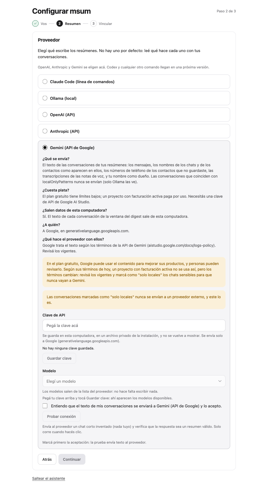

# Sacar una clave de API de Google (Gemini) y usarla en msum

Una clave de API es una contraseña que le permite a msum pedirle a Gemini (el modelo de Google) que escriba tus resúmenes. Tarda unos 5 minutos. Necesitás una cuenta de Google.

## Qué se envía y a quién

- El texto de tus conversaciones sale de tu computadora y va a Google (API de Gemini), con tu clave de API.
- Las conversaciones marcadas como "solo local" nunca se envían a un proveedor externo, y Gemini lo es.
- Con el plan gratuito, Google puede usar el contenido para mejorar sus productos, y personas pueden revisarlo. Según sus términos de hoy, un proyecto con facturación activa no se usa así, pero los términos cambian: revisá los vigentes en <https://aistudio.google.com/docs/logs-policy> y marcá como "solo locales" los chats sensibles.
- Costos: la página oficial de precios (<https://aistudio.google.com/docs/pricing>) describe un plan gratuito para empezar y un plan pago con límites más altos. Los límites y precios cambian: mirá esa página antes de decidir. msum no cobra nada.

## Paso a paso

1. Abrí <https://aistudio.google.com/apikey> (es el botón "Create or view a Gemini API Key" de la documentación de Google) e iniciá sesión con tu cuenta de Google.
2. Si es tu primera vez, aceptá los términos de servicio. Google AI Studio crea un proyecto y una clave por defecto.
3. En el panel, entrá a la página **API Keys** y tocá **Create API key**.
   > Captura pendiente: la página API Keys de AI Studio con el botón "Create API key" resaltado (con la clave, el correo y el proyecto tapados).
4. Copiá la clave que aparece. Tratala como una contraseña: no la mandes por chat ni la subas a ningún lado.
5. Abrí msum (`msum open` en una terminal). Hay dos caminos; el resultado es el mismo.

   **Camino A: el asistente de primer uso** (paso **Resumen**, el segundo de los tres)

   1. Elegí **Gemini (API de Google)** y leé el aviso que aparece debajo.
   2. En **Clave de API** pegá la clave y tocá **Guardar clave**. El campo se vacía y la clave no se vuelve a mostrar: es normal. Queda guardada solo en tu computadora.
      
   3. Justo debajo, en **Modelo**, aparece la lista de modelos de Gemini (hasta que guardes la clave, el campo está deshabilitado y dice cómo habilitarlo). Elegí uno: la opción inicial dice "Elegí un modelo".
   4. Marcá la casilla "Entiendo que el texto de mis conversaciones se enviará a Gemini (API de Google) y lo acepto."
   5. Tocá **Probar conexión**. msum le manda a Google un chat corto inventado (nada tuyo) y verifica que la respuesta sea un resumen válido. Si sale bien, tocá **Continuar**.

   **Camino B: si ya configuraste todo** (**Ajustes**, grupo "Proveedor de resumen")

   1. En **Proveedor principal** elegí **Gemini (API de Google)**. Debajo aparecen la clave y el modelo.
   2. En **Clave de API** pegá la clave y tocá **Guardar clave** (se guarda en el momento, sin esperar a **Guardar cambios**).
   3. En **Modelo de Gemini** elegí uno de la lista.
   4. Tocá **Guardar cambios**. La primera vez aparece **Aceptación para usar un proveedor externo**: leé el aviso, marcá la casilla "Entiendo que el texto de mis conversaciones se enviará a …" y tocá **Aceptar y continuar**.
   5. En Ajustes no hay un botón de prueba: la prueba de conexión está en el asistente.

## Si algo falla

1. **"El proveedor rechazó la clave"** (al probar la conexión) o **"El proveedor no aceptó la clave. Guardala de nuevo para ver los modelos"** (donde se elige el modelo): la clave está mal copiada (sobran espacios o faltan letras) o fue borrada. Volvé a AI Studio, copiala de nuevo y usá **Reemplazar clave**. Si Google te marca la clave como bloqueada o sin restricciones, creá una nueva en la misma página.
2. **"No se pudo conectar con el proveedor"** (al probar) o **"No pudimos conectar con el proveedor para pedirle los modelos"** (en la lista de modelos): revisá tu conexión a internet y, en la lista, tocá **Volver a buscar**.
3. **"El proveedor no nos dio una lista de modelos que se pueda usar"**: tocá **Volver a buscar** en un rato. msum no inventa una lista para Gemini: sin la lista del proveedor no se puede elegir modelo.

## Referencias oficiales

- Clave de API: <https://aistudio.google.com/docs/api-key> (antes <https://ai.google.dev/gemini-api/docs/api-key>)
- Precios: <https://aistudio.google.com/docs/pricing>

---

Volver al [README](../../README.es.md) · [Índice de guías](README.md)
