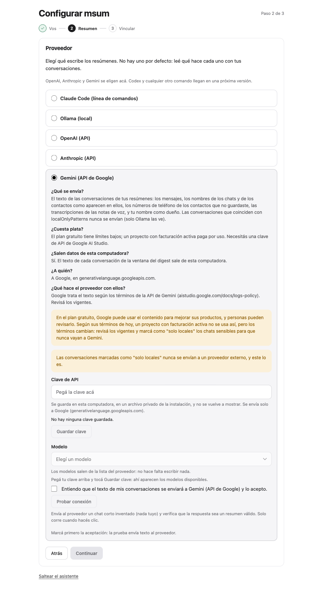

# Getting a Google API key (Gemini) and using it in msum

An API key is a password that lets msum ask Gemini (Google's model) to write your digests. It takes about 5 minutes. You need a Google account.

> The screenshots in this guide show the Spanish interface (they are shared with the [Spanish guide](../guias/sacar-clave-api-google.md)). The English labels used in the text are the ones the page shows when its language is English.

## What is sent and to whom

- The text of your conversations leaves your computer and goes to Google (Gemini API), with your API key.
- Conversations marked "local only" are never sent to an external provider, and Gemini is external.
- On the free plan, Google may use the content to improve its products, and people may review it. According to its terms today, a project with billing enabled is not used that way, but terms change: check the current ones at <https://aistudio.google.com/docs/logs-policy> and mark sensitive chats as "local only".
- Costs: the official pricing page (<https://aistudio.google.com/docs/pricing>) describes a free plan to get started and a paid plan with higher limits. Limits and prices change: look at that page before deciding. msum charges nothing.

## Step by step

1. Open <https://aistudio.google.com/apikey> (it is the "Create or view a Gemini API Key" button in Google's documentation) and sign in with your Google account.
2. If it is your first time, accept the terms of service. Google AI Studio creates a project and a default key.
3. In the dashboard, go to the **API Keys** page and press **Create API key**.
   > Screenshot pending: the AI Studio API Keys page with the "Create API key" button highlighted (with the key, the email and the project covered).
4. Copy the key that appears. Treat it like a password: do not send it in a chat or upload it anywhere.
5. Open msum (`msum open` in a terminal). There are two paths; the result is the same.

   **Path A: the first-run wizard** (the **Summary** step, the second of three)

   1. Choose **Gemini (Google API)** and read the notice that appears below.
   2. Under **API key** paste the key and press **Save key**. The field empties and the key is not shown again: that is normal. It stays saved only on your computer.
      
   3. Right below, under **Model**, the list of Gemini models appears (until you save the key, the field is disabled and says how to enable it). Choose one: the initial option says "Choose a model".
   4. Tick the box "I understand that the text of my conversations will be sent to Gemini (Google API) and I agree."
   5. Press **Test connection**. msum sends Google a short made-up chat (nothing of yours) and checks that the answer is a valid digest. If it works, press **Continue**.

   **Path B: if you already set everything up** (**Settings**, group "Summarization provider")

   1. Under **Main provider** choose **Gemini (Google API)**. The key and the model appear below.
   2. Under **API key** paste the key and press **Save key** (it is saved right away, without waiting for **Save changes**).
   3. Under **Gemini model** choose one from the list.
   4. Press **Save changes**. The first time, **Agreement to use an external provider** appears: read the notice, tick the box "I understand that the text of my conversations will be sent to …" and press **Agree and continue**.
   5. Settings has no test button: the connection test is in the wizard.

## If something fails

1. **"The provider rejected the key"** (when testing the connection) or **"The provider did not accept the key. Save it again to see the models"** (where the model is chosen): the key was copied wrong (extra spaces or missing letters) or was deleted. Go back to AI Studio, copy it again and use **Replace key**. If Google marks the key as blocked or unrestricted, create a new one on the same page.
2. **"The provider could not be reached"** (when testing) or **"We could not reach the provider to ask for its models"** (in the model list): check your internet connection and, in the list, press **Look again**.
3. **"The provider did not give us a usable list of models"**: press **Look again** in a while. msum does not invent a list for Gemini: without the provider's list you cannot choose a model.

## Official references

- API key: <https://aistudio.google.com/docs/api-key> (formerly <https://ai.google.dev/gemini-api/docs/api-key>)
- Pricing: <https://aistudio.google.com/docs/pricing>

---

Back to the [README](../../README.md) · [Guides index](README.md)
