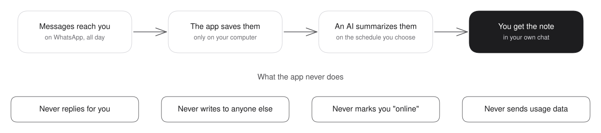
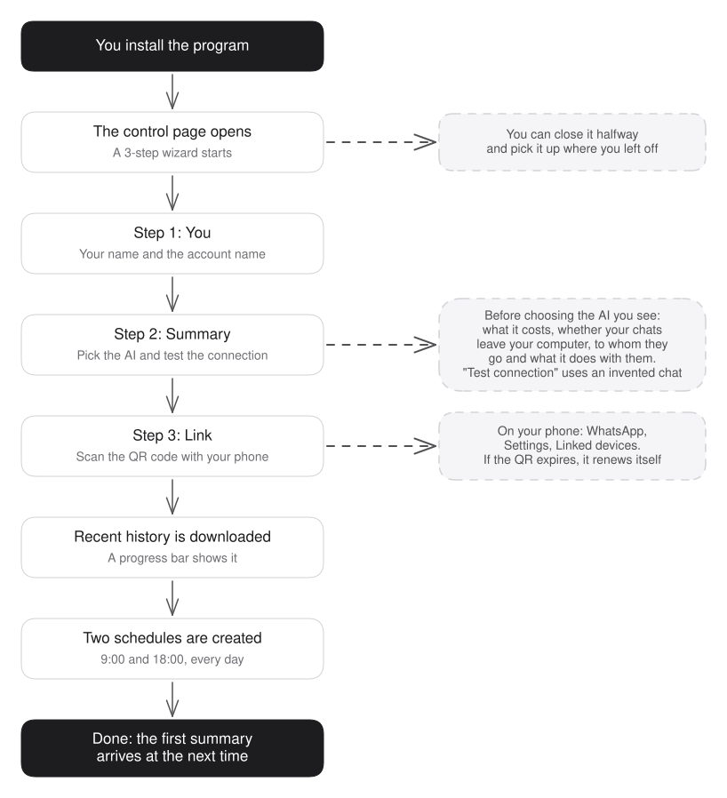
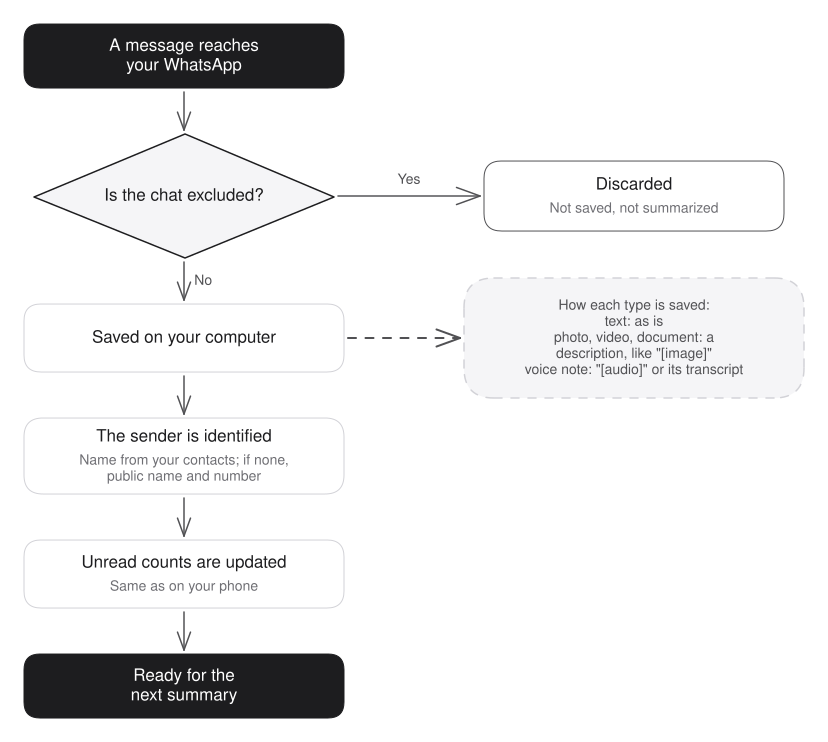
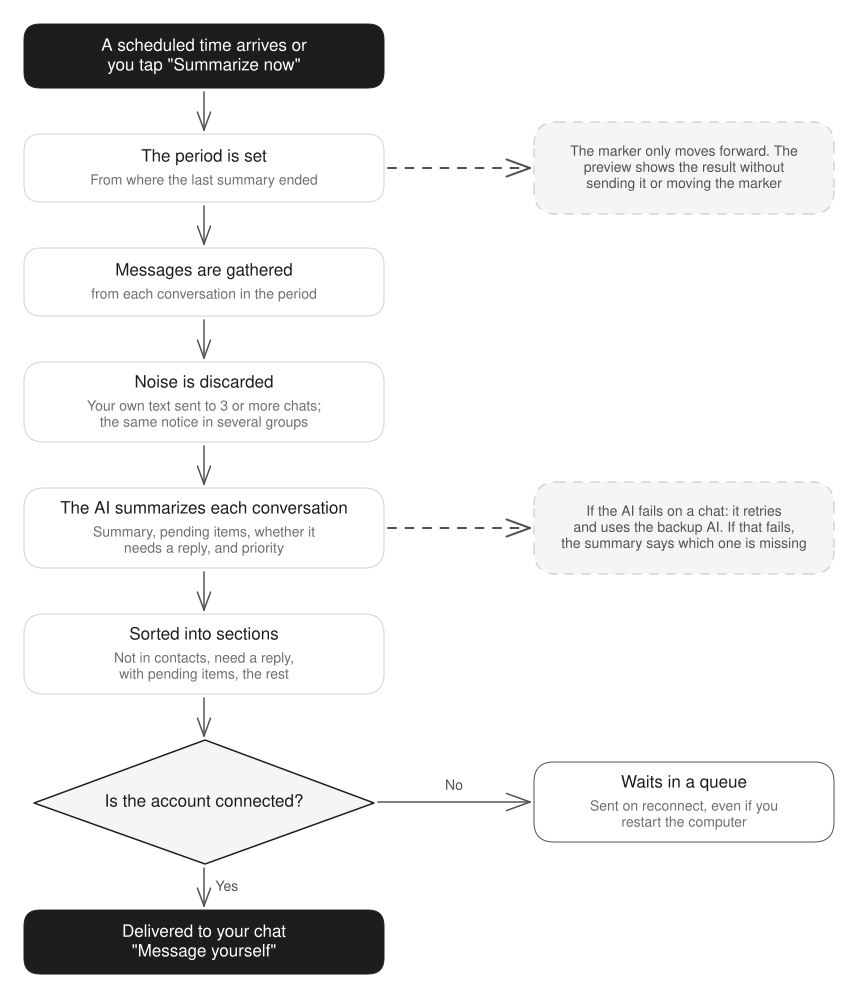
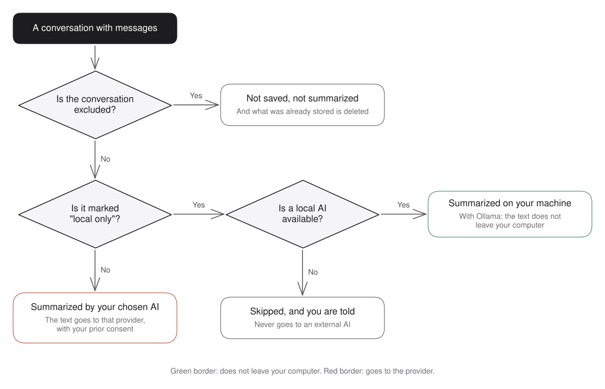
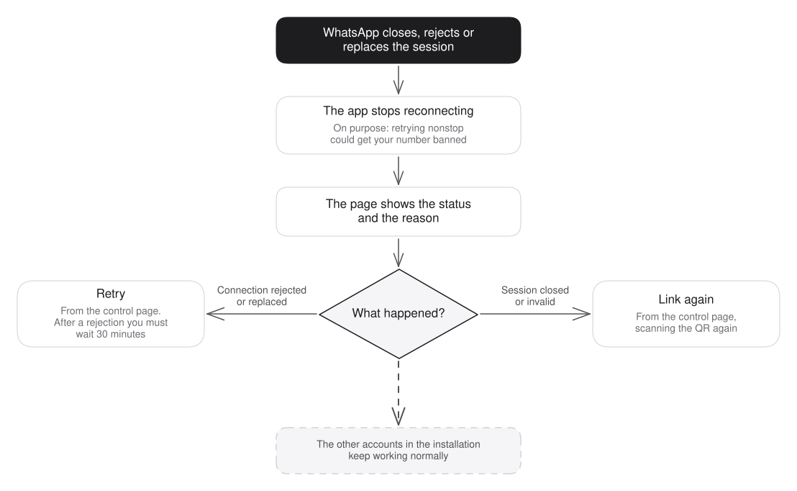

# How message-summarize works, explained without jargon

This document is for anyone, whether or not they know how to program. It explains what problem the app solves and what happens, step by step, from the moment a message reaches you until you receive the summary. [Español](../guias/como-funciona.md) · Back to the [README](../../README.md) · [Guide index](README.md).

## The problem

If you get a lot of messages every day (work chats, family groups, school, clients), three things happen:

- You don't know **which ones you have to answer** and which can wait.
- **Pending requests get lost**: someone asked you for something among twenty messages in a group.
- You waste a lot of time **opening chat after chat** only to find nothing important.

## What the app does

It is like having an assistant who, while you are not looking at your phone, **reads everything that reached you and leaves you a short note** with what matters:

> "Ana asks if you can make it on Thursday: **needs a reply**. The school group says there are no classes on Friday: **informational only**. Pedro sent you the quote: **pending review**."

That note is called a **summary** (in the code and the technical guides, a *digest*). It arrives in your own WhatsApp chat, the one called "Message yourself", at the times you choose (for example, at 9:00 and at 18:00).

## What it does NOT do

These guarantees are part of the design, not a detail:

- **It does not reply to messages for you.** It only reads.
- **It does not write to anyone else.** The only message it sends is the summary, and it goes only to your own chat. Not even to another of your accounts installed in the same program.
- **It does not mark you "online"**, so your phone keeps ringing with its usual notifications.
- **It does not send statistics or data to anyone.** It has no telemetry.
- **It does not put your chats on the internet.** The control page opens only on the computer where the program is installed.

## The pieces, with an analogy

Picture a small office:

| Piece | Analogy | What it is in reality |
|---|---|---|
| **The program that runs in the background** | The manager who never leaves the office | It is called the *daemon*. It is the only thing that stays on: it keeps the connection to WhatsApp, saves messages, watches the clock and delivers the summaries |
| **Your WhatsApp account** | The door the mail comes through | It connects as a "linked device", just like WhatsApp Web |
| **The local database** | The office's filing cabinet | All messages are saved **only on your computer** |
| **The AI (the "provider")** | The employee who reads and writes | A language model: Claude, ChatGPT, Gemini or Ollama (which runs on your own machine). You choose it |
| **The schedules** | The alarm clock | Rules like "every day at 9:00 and at 18:00" |
| **The local web page** | The control panel | A page that opens in your browser to set everything up |

## Flow 1: the first time (install it and leave it running)

The whole route is designed so that someone with no technical knowledge can complete it in about 10 minutes.

Details worth knowing:

- **Choosing the AI is mandatory and it is your decision.** There is no default. The screen explains what each option costs, whether your chats leave your computer, to whom they go and what that company does with them.
- **"Test connection"** makes a real call, but with an invented conversation. It never uses your messages to test.
- **The QR code** is the same mechanism you use to open WhatsApp Web: from your phone, *Settings → Linked devices*. If it expires, it renews itself.
- If you close the wizard halfway, **you can pick it up again** where you left off.

## Flow 2: day to day, while you are not looking at your phone

Every message that arrives follows this path automatically:

Things the app takes into account:

- **Edits.** If someone edits a message, the summary uses the new version.
- **Read and unread.** If you read a chat on your phone, the app finds out. You can ask the summary to include **only what you have not read**.
- **Internet outages.** If the connection drops, the app comes back by itself and recovers what WhatsApp resends.
- **Voice notes (optional).** They can be turned into text **inside your computer**. The audio is never sent to any service.

## Flow 3: how a summary is built

This happens every time a scheduled time arrives, or when you tap **"Summarize now"**:

### How the summary is sorted

1. Contacts **not in your address book** (optional, so you don't miss them).
2. Chats that **need a reply**.
3. Chats **with pending items**.
4. **The rest** (what you can ignore). If you like, the message shows only how many there are, and the detail stays saved in the history.

Within each section, the highest priority comes first, then the ones with the most messages.

### "Since when?": the marker

Each summary **starts exactly where the previous one ended**, so messages are never repeated or skipped. It is like a bookmark that only moves forward.

- The **preview** shows what a summary would look like **without sending it and without moving the bookmark**.
- The first time, when there is no bookmark yet, it covers the last 24 hours (configurable).
- You can also ask for a specific period, for example "the last 6 hours".

### What happens when something goes wrong

The app is designed **not to stop because of a single problem**:

| Situation | What the app does |
|---|---|
| The AI fails on a conversation | It retries and, if you set up a backup AI, uses that one. The summary says which ones were done with the backup |
| The AI returns an unreadable answer | It treats it as a failure of that conversation; it does not cut the whole summary |
| The AI's free plan ran out of quota | It waits the time the provider indicates and retries. If that is not enough, it delivers what it managed and says which chats are missing |
| A conversation is very long | It trims the oldest messages and says so |
| Your computer was off at the scheduled time | When it turns on, it produces **one** pending summary (not one for every missed time) |
| WhatsApp is disconnected when the summary is ready | It waits in a queue and is sent as soon as it reconnects, even if you restart the computer |
| You ask for a summary while another is being built | It waits or tells you; two never run at the same time for the same account |

## Flow 4: your privacy, step by step

This is the most sensitive point, because your chats contain conversations of other people. This diagram shows where each conversation goes:

Where each thing lives: messages, audio, transcripts and summaries **only on your computer**; the text of the conversations, at the moment of summarizing, **goes to the AI you chose**; and with Ollama (an AI installed on your own machine) **nothing leaves**.

The tools you have to control it:

- **Excluding a chat:** the app does not save or summarize it. The messages it had already saved from that chat are deleted.
- **Marking a chat "local only":** it is summarized only with an AI that runs on your machine. If none is available, that chat **is skipped** and you are told. It is **never** sent to an external AI.
- **Explicit consent:** before using an external AI, the app shows you what data it receives and who gets it, and asks you to accept. That is recorded.
- **Access to the page:** only from your computer and with an access key (token) generated at install time.
- **Keys and the WhatsApp session:** stored with restricted file permissions and never shown in the activity logs.
- **AIs used through their command-line program** (like Claude Code) run **without tools**, in an empty folder and with a time limit, because the text of a chat is written by third parties and could contain malicious instructions.

## Flow 5: what you can do from the control page

It opens with the command `msum open` and has these sections:

| Section | What it is for |
|---|---|
| **Summary** (home) | See whether each account is connected, when the last summary was and when the next one is. "Summarize now" and "Preview" buttons |
| **Conversations** | Search chats and mark them as excluded or "local only" |
| **Schedules** | Create, change or delete schedules. Changes apply immediately |
| **History** | See complete past summaries, which AI made them and whether there were errors |
| **Settings** | Change AI, model, keys, name, language, time zone and the text of the instructions given to the AI |

There is also a **logs** view (what the program did, with no messages or names) for when something does not work.

## Flow 6: when WhatsApp cuts the session

Sometimes WhatsApp closes the session (for example, if you remove it from your phone) or rejects the connection. In that case:

1. The app **stops trying** to connect that account, on purpose: retrying nonstop could get your number banned.
2. The page shows you the status and the reason.
3. You decide: **retry** (after a rejection, the page makes you wait 30 minutes) or **link again** by scanning the QR code once more.

If you have several accounts, a problem in one **does not affect the others**.

## Several accounts

One installation can handle several WhatsApp accounts (for example, your personal one and your work one). Each has its own messages, schedules, settings and summaries, and **each summary goes only to the account that was summarized**. Deleting an account removes only its data.

## A risk you need to know about

The application connects to WhatsApp with an **unofficial** client. WhatsApp does not allow unofficial clients and **may ban the number**, temporarily or permanently. The project reduces that risk (it only reads, does not write to third parties, does not mark itself online), but it cannot remove it. Any change that makes the program send messages to other people, or changes how it connects, increases that risk. The full warning is in the [README](../../README.md#important-warning).

## What you need to use it

- A WhatsApp account and your phone at hand to scan the QR code.
- A computer that stays **on** (schedules are only met if it is on and the program is running; if you need a full guarantee, you need a server).
- An AI to summarize: it can be a plan you already pay for (Claude), a key for a service (OpenAI, Anthropic, Gemini; Gemini has a free plan, with privacy warnings) or Ollama, which is free and runs on your machine.

## Quick glossary

| Word | What it means |
|---|---|
| **Summary / digest** | The note with what matters from all your chats over a period |
| **Account** | A linked WhatsApp number |
| **Conversation** | An individual chat or a group |
| **Provider** | The AI that reads and summarizes |
| **Schedule** | A rule like "Monday to Friday at 9:00" |
| **Daemon** | The program that keeps running in the background |
| **Local only** | A chat that is summarized only with an AI installed on your machine |
| **Preview** | A trial summary that is neither sent nor recorded |

---

For the technical detail of each part: [providers](providers.md) · [web and accounts](web-and-accounts.md) · [daemon and schedules](daemon-and-schedules.md) · [network and privacy](network-and-privacy.md) · [requirements](../requirements.md) (Spanish).
