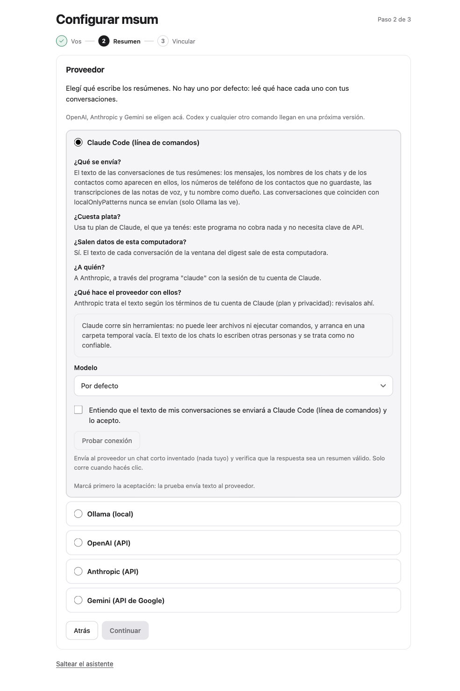

# Installing Claude Code and signing in (to use "Claude (command line)" in msum)

msum can ask the `claude` program (Claude Code) for the digests, using the Claude plan you already have. It needs no API key and msum charges nothing.

> The screenshots in this guide show the Spanish interface (they are shared with the [Spanish guide](../guias/instalar-claude-y-login.md)). The English labels used in the text are the ones the page shows when its language is English.

## What is sent and to whom

- The text of each conversation leaves your computer and goes to Anthropic, with your Claude session.
- Anthropic handles the text under the terms of your Claude account (plan and privacy settings): check them there.
- Conversations marked "local only" are never sent to an external provider, and this one is external.
- Claude runs without tools: it cannot read files or run commands.
- Costs: you need a Claude account (Pro, Max, Team or Enterprise) or a Claude Console account, according to the official documentation. See the current plans and prices at <https://claude.com/pricing>.

## Step by step

1. **Open a terminal** (the window where you type commands).
   - macOS: press `Cmd + Space`, type `Terminal` and `Enter`.
   - Windows: press `Win + X` and choose **Windows PowerShell** (or **Terminal**). You should see `PS C:\...` at the start of the line.
   - Linux: `Ctrl + Alt + T`, or look for "Terminal" in the applications menu.
2. **Install Claude Code**: copy the line for your system, paste it and press `Enter`. It shows no progress: wait until it says "Claude Code successfully installed!".
   - macOS and Linux: `curl -fsSL https://claude.ai/install.sh | bash`
   - Windows (PowerShell): `irm https://claude.ai/install.ps1 | iex`
   - Windows (CMD, if you do not have PowerShell): `curl -fsSL https://claude.ai/install.cmd -o install.cmd && install.cmd && del install.cmd`
   - Official alternatives: on macOS, `brew install --cask claude-code`; on Windows, `winget install Anthropic.ClaudeCode`.
3. **Check that it is installed**: open a new terminal and type `claude --version`. It should show a version number.
4. **Sign in**: type `claude` and `Enter`. The first time, the browser opens so you can sign in with your Claude account. If the browser does not open, press `c` to copy the link and paste it into the browser. If the browser shows a code, paste it into the terminal where it says `Paste code here if prompted`.
   > Screenshot pending: Claude's sign-in screen (without showing a real account, email or data).
5. When the terminal says `Login successful`, press `Enter`. Afterwards you can leave by typing `/exit`.
6. **Choose it in msum**: open msum (`msum open`). There are two paths; the result is the same.

   **Path A: the first-run wizard** (the **Summary** step, the second of three)

   1. Choose **Claude Code (command line)** and read the notice that appears below.
   2. Under **Model** you can leave "Default" or choose **Sonnet**, **Opus** or **Haiku** (the list is fixed, there is nothing to type).
   3. Tick the box "I understand that the text of my conversations will be sent to … and I agree."
   4. Press **Test connection**. msum sends Claude a short made-up chat (nothing of yours) and checks the answer. If it works, press **Continue**.
      

   **Path B: if you already set everything up** (**Settings**, group "Summarization provider")

   1. Under **Main provider** choose **Claude (command line)**.
   2. If you want, choose a model under **Claude model** (Sonnet, Opus or Haiku; empty uses the usual one).
   3. Press **Save changes**. The first time, **Agreement to use an external provider** appears: read the notice, tick the box and press **Agree and continue**.
   4. Settings has no test button: the connection test is in the wizard.

## If something fails

1. **`claude` is not recognized or "command not found"**: the installer is not on the PATH yet. Close the terminal and open a new one. If it stays the same, follow the "Fix your PATH" section of <https://code.claude.com/docs/en/troubleshoot-install.md>. If on Windows you see `irm is not recognized`, you are in CMD: open PowerShell.
2. **The test fails because there is no session**: go back to the terminal, type `claude` and, inside, `/login`. If you have the `ANTHROPIC_API_KEY` variable set, Claude Code may use it instead of your plan: the official documentation says `unset ANTHROPIC_API_KEY` (macOS and Linux) to go back to your subscription.
3. **No internet, or the installer returns an error**: check your connection and repeat the command.

## Official references

- Installation: <https://code.claude.com/docs/en/quickstart> and <https://code.claude.com/docs/en/terminal-guide>
- Sign-in: <https://code.claude.com/docs/en/authentication>

---

Back to the [README](../../README.md) · [Guides index](README.md)
